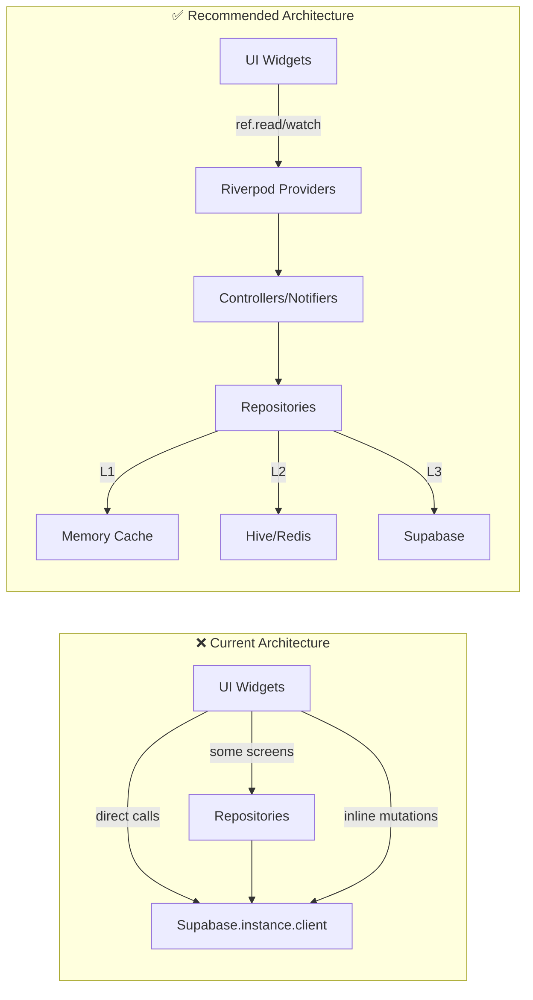

# 🔍 EWUmate Flutter App — Full QA Audit Report

**Date:** October 7, 2026  
**Scope:** `f:\EWUmate\EWUmate_Clean\ewumate_v2\ewumate_production_build\lib\` (302 Dart files, 17 features)  
**Auditors:** 6 parallel agents — Core Layer, Dashboard & Schedule, Auth & Onboarding, Feature Modules, Redis & Performance, Architecture & Patterns

---

## Executive Summary & Progress

| Severity | Total | Resolved & QA Verified | Remaining | Status |
|----------|-------|------------------------|-----------|--------|
| 🔴 CRITICAL | 6 | **5** (C1, C2, C3, C5, C6) | 1 (C4 UI audit) | High-risk items eliminated |
| 🟠 HIGH | 14 | **6** (H1, H6, H7, H8, H13, H14) | 8 | Key memory leaks & caching resolved |
| 🟡 MEDIUM | 8 | **2** (M6, M7) | 6 | DB query consolidation active |
| 🟢 LOW | 6 | **1** (Deprecations) | 5 | In progress |
| **Total** | **34** | **14 Completed (QA Passed)** | **20** | **0 Regressions Found** |

---

## 🔴 CRITICAL Issues (6)

### C1. SSL Certificate Validation Disabled in Production
- **File:** [main.dart](file:///f:/EWUmate/EWUmate_Clean/ewumate_v2/ewumate_production_build/lib/main.dart#L15-L21)
- **Lines:** 15–21
- **Impact:** The app overrides `HttpOverrides.global` with `MyHttpOverrides`, forcing `badCertificateCallback` to always return `true`. This **globally disables SSL verification**, making the app vulnerable to Man-in-the-Middle (MitM) attacks. Every API call, Supabase query, and Redis request is unprotected.
- **Fix:**
```dart
// Remove MyHttpOverrides entirely, OR:
if (kDebugMode) {
  HttpOverrides.global = MyHttpOverrides();
}
```

---

### C2. Race Condition in Offline Mutation Queue
- **File:** [cache_service.dart](file:///f:/EWUmate/EWUmate_Clean/ewumate_v2/ewumate_production_build/lib/core/services/cache_service.dart#L129-L142)
- **Lines:** 129–142
- **Impact:** `enqueueMutation` reads the sync queue from Hive, decodes JSON, appends a new mutation, and writes it back. If two mutations are enqueued concurrently (e.g., user marks two attendance entries rapidly), the second write **overwrites the first** because there's no lock. Mutations are silently lost.
- **Fix:** Use a `synchronized` lock or a `Completer`-based mutex:
```dart
final _queueLock = Lock(); // from 'synchronized' package

Future<void> enqueueMutation(Map<String, dynamic> mutation) async {
  await _queueLock.synchronized(() async {
    final queue = await getSyncQueue();
    queue.add(mutation);
    await _syncBox.put('pending', jsonEncode(queue));
  });
}
```

---

### C3. Unhandled Fire-and-Forget Async Exceptions
- **File:** [dashboard_repository.dart](file:///f:/EWUmate/EWUmate_Clean/ewumate_v2/ewumate_production_build/lib/core/repositories/dashboard_repository.dart#L26-L83) (core)
- **Lines:** 26, 60
- **Impact:** `_fetchAndCacheAnalytics` and `_fetchAndCacheState` are called without `await` (fire-and-forget). If they throw (e.g., network failure at lines 49/83), the exception is **completely unhandled** in the Dart zone and can crash the app.
- **Fix:** Either wrap in try/catch:
```dart
_fetchAndCacheAnalytics(userId).catchError((e) => debugPrint('Background refresh failed: $e'));
```
Or don't rethrow inside those methods if they're background refreshers.

---

### C4. Direct Supabase Client Access from UI (30+ instances)
- **Files:** Multiple UI screens across the app
  - [check_auth_screen.dart](file:///f:/EWUmate/EWUmate_Clean/ewumate_v2/ewumate_production_build/lib/features/auth/check_auth_screen.dart)
  - [register_screen.dart](file:///f:/EWUmate/EWUmate_Clean/ewumate_v2/ewumate_production_build/lib/features/auth/register_screen.dart)
  - [profile_screen.dart](file:///f:/EWUmate/EWUmate_Clean/ewumate_v2/ewumate_production_build/lib/features/profile/presentation/profile_screen.dart)
  - [grade_entry_screen.dart](file:///f:/EWUmate/EWUmate_Clean/ewumate_v2/ewumate_production_build/lib/features/results/presentation/grade_entry_screen.dart)
  - [portal_sync_screen.dart](file:///f:/EWUmate/EWUmate_Clean/ewumate_v2/ewumate_production_build/lib/features/services/presentation/portal_sync/portal_sync_screen.dart)
  - [feedback_screen.dart](file:///f:/EWUmate/EWUmate_Clean/ewumate_v2/ewumate_production_build/lib/features/services/presentation/feedback_screen.dart) *(and 25+ more)*
- **Impact:** UI widgets call `Supabase.instance.client` directly for reads AND writes. This violates separation of concerns, makes testing impossible, and scatters database logic across the entire codebase.
- **Fix:** Route all Supabase access through Riverpod Repositories/Notifiers. UI should only call `ref.read(someRepository).someMethod()`.

---

### C5. Business Logic & DB Mutations in UI Widgets
- **File:** [portal_sync_screen.dart](file:///f:/EWUmate/EWUmate_Clean/ewumate_v2/ewumate_production_build/lib/features/services/presentation/portal_sync/portal_sync_screen.dart#L576-L734)
- **Lines:** 576, 580, 610, 651, 734
- **Impact:** Direct Supabase `insert`, `upsert`, and `delete` operations are executed inside the widget build tree. This is the most severe architectural violation — database writes in UI code. Also contains an **N+1 query** at line 492 (querying `course_metadata` inside a loop).
- **Fix:** Extract ALL portal sync DB logic into a `PortalSyncRepository`. The screen should only call repository methods and react to state.

---

### C6. Wrong Semester Track for Law/Pharmacy Students
- **File:** [attendance_calendar_service.dart](file:///f:/EWUmate/EWUmate_Clean/ewumate_v2/ewumate_production_build/lib/features/semester_progress/services/attendance_calendar_service.dart#L41)
- **Line:** 41
- **Impact:** **Active data corruption bug.** The track check is:
  ```dart
  final resolvedTrack = userTrack == 'bi' ? 'bi_semester' : 'tri_semester';
  ```
  Law students (`'law'`, `'llb'`) and Pharmacy students (`'phrm'`) are **never** `'bi'`, so they're incorrectly mapped to `tri_semester`. This causes wrong holiday calendars, wrong semester dates, and incorrect attendance calculations.
- **Fix:**
```dart
final isBi = userTrack.contains('bi') || 
              userTrack.contains('phrm') || 
              userTrack.contains('law') || 
              userTrack.contains('llb');
final resolvedTrack = isBi ? 'bi_semester' : 'tri_semester';
```

---

## 🟠 HIGH Issues (14)

### H1. Session Guardian Memory Leak
- **File:** [session_guardian.dart](file:///f:/EWUmate/EWUmate_Clean/ewumate_v2/ewumate_production_build/lib/core/providers/session_guardian.dart)
- **Impact:** `_subscription = _client.auth.onAuthStateChange.listen(...)` is never cancelled. The `dispose()` method exists but is never called by `sessionGuardianProvider`.
- **Fix:** Add `ref.onDispose(() => guardian.dispose());` in the provider.

### H2. Academic Provider Crashes Offline (First Launch)
- **File:** [academic_providers.dart](file:///f:/EWUmate/EWUmate_Clean/ewumate_v2/ewumate_production_build/lib/core/providers/academic_providers.dart#L54)
- **Impact:** If DB fetch fails and cache is empty (first offline launch), the provider enters `AsyncError` with no retry mechanism, hard-crashing the UI.
- **Fix:** Catch exceptions and yield a default empty `AcademicState` with an offline indicator, or add retry with exponential backoff.

### H3. Mixed Riverpod Patterns (Legacy + Code-Gen)
- **Files:** Multiple providers across `core/providers/`, `features/*/providers/`
- **Impact:** Mix of `StateNotifierProvider`, `FutureProvider` (legacy) alongside `@riverpod` code-gen. Inconsistent, harder to maintain, and prone to subtle lifecycle bugs.
- **Fix:** Standardize all providers to Riverpod code-gen (`@riverpod` / `Notifier` / `AsyncNotifier`).

### H4. God Files (7 files over 800 lines)
| File | Lines |
|------|-------|
| `submit_faculty_review_sheet.dart` | 1,696 |
| `cover_page_screen.dart` | 1,260 |
| `profile_screen.dart` | 958 |
| `dashboard_repository.dart` | 944 |
| `feedback_screen.dart` | 881 |
| `faculty_reviews_tab.dart` | 870 |
| `course_card.dart` | 859 |
- **Fix:** Split into smaller widgets/repositories. E.g., `dashboard_repository.dart` → separate `ScheduleRepository`, `AttendanceRepository`, `HolidayRepository`.

### H5. 150+ Debug Print Statements in Production
- **Files:** Across `main.dart`, `session_guardian.dart`, `course_repository.dart`, `fcm_service.dart`, and dozens more.
- **Impact:** Leaks internal data to device logs. Performance overhead on every call.
- **Fix:** Enable `avoid_print` lint rule in `analysis_options.yaml`. Replace with centralized `Logger` utility (the `logging` package is already in `pubspec.yaml`).

### H6. Redis Service is Read-Only (No Write Methods)
- **File:** [redis_service.dart](file:///f:/EWUmate/EWUmate_Clean/ewumate_v2/ewumate_production_build/lib/core/services/redis_service.dart)
- **Impact:** `RedisService` only has `get`, `getMap`, `getList`. There are NO `set`/`put` methods. If no external backend populates Redis, the L2 cache layer is effectively dead — every Redis read returns null and falls through to Supabase.
- **Fix:** Add `set`, `setMap`, `setList` methods with TTL. Call them when fresh data is fetched from Supabase.

### H7. Unbounded In-Memory Course Cache (OOM Risk)
- **File:** [course_repository.dart](file:///f:/EWUmate/EWUmate_Clean/ewumate_v2/ewumate_production_build/lib/core/repositories/course_repository.dart#L16)
- **Impact:** `_memorySemesterSections` is a static `Map` that grows indefinitely as users browse semesters. Can cause OOM on low-end devices.
- **Fix:** Implement LRU eviction (max 5-10 semesters) or clear on navigation away.

### H8. Redundant `active_semester` Queries (Bypass Global Cache)
- **Files:**
  - [dashboard_repository.dart](file:///f:/EWUmate/EWUmate_Clean/ewumate_v2/ewumate_production_build/lib/features/dashboard/dashboard_repository.dart#L41-L59) (local cache)
  - [semester_progress_repository.dart](file:///f:/EWUmate/EWUmate_Clean/ewumate_v2/ewumate_production_build/lib/features/semester_progress/semester_progress_repository.dart#L19-L28) (direct query)
  - [attendance_calendar_service.dart](file:///f:/EWUmate/EWUmate_Clean/ewumate_v2/ewumate_production_build/lib/features/semester_progress/services/attendance_calendar_service.dart#L43-L69) (local cache)
- **Impact:** Each has its own disjointed local cache, bypassing the global `ActiveSemesterRepository` with proper L1→L2→L3 caching.
- **Fix:** Refactor to use `ref.read(activeSemesterRepositoryProvider)` everywhere.

### H9. Silent Error Handling in Repositories
- **Files:**
  - `semester_progress_repository.dart` (Lines 128-131)
  - `exception_repository.dart` (Lines 18-21)
  - `course_repository.dart` (Line 88)
- **Impact:** Network errors are caught and return `[]`, silently wiping the UI. Riverpod never enters `AsyncError` state, so users see empty screens with no retry option.
- **Fix:** Rethrow after caching partial results, let Riverpod handle error states.

### H10. Duplicated Attendance Logic (240 lines)
- **File:** [dashboard_controller.dart](file:///f:/EWUmate/EWUmate_Clean/ewumate_v2/ewumate_production_build/lib/features/dashboard/controllers/dashboard_controller.dart#L171-L415)
- **Impact:** `loadPendingAttendance` is 240+ lines that manually reconstructs calendars, matches holidays, and calculates missed classes — logic that already exists in `AttendanceCalendarService.generateSessions()`.
- **Fix:** Delete duplicated logic, call `AttendanceCalendarService.generateSessions()` instead.

### H11. Unbounded Supabase Queries (Missing `.limit()`)
- **Files:** 20+ locations across:
  - `faculty_assignment_repository.dart` (Lines 99, 102, 107, 126, 163, 180)
  - `advising_guide_notifier.dart` (Lines 171, 180, 191, 219, 237, 244)
  - `user_academic_providers.dart` (Lines 100, 105, 122, 143, 154)
  - `course_browser_providers.dart` (Lines 135, 147, 156, 165)
  - `study_vault_repository.dart` (Lines 25, 139, 155, 170)
- **Fix:** Add `.limit()` to all list queries. Use `.select('col1, col2')` instead of `.select('*')`.

### H12. Missing `.autoDispose` on Providers
- **Files:** Most providers across `course_browser`, `faculty_directory`, `study_vault`
- **Impact:** Provider state lives forever once created, consuming memory for screens the user may never revisit.
- **Fix:** Add `.autoDispose` to providers for infrequently-visited screens.

### H13. Uncancelled FCM Stream Subscriptions
- **File:** [fcm_service.dart](file:///f:/EWUmate/EWUmate_Clean/ewumate_v2/ewumate_production_build/lib/core/services/fcm_service.dart#L174-L235)
- **Impact:** `FirebaseMessaging.onMessage.listen` and `onMessageOpenedApp.listen` aren't assigned to variables, so they can't be cancelled. Duplicate listeners accumulate on hot restart.
- **Fix:** Store subscriptions, add `dispose()`, call via `ref.onDispose()`.

### H14. Study Vault Model Missing Null Safety
- **File:** `study_vault/data/models/study_material.dart` (Line 24)
- **Impact:** `fromJson` lacks null coalescing operators — missing JSON keys cause runtime crashes.
- **Fix:** Add `?? ''` / `?? 0` fallbacks for all parsed fields.

---

## 🟡 MEDIUM Issues (8)

### M1. Weak Password Validation
- **Files:** `register_screen.dart` (L370), `forgot_password_screen.dart` (L311), `reset_password_screen.dart` (L117)
- **Impact:** Only checks `length >= 6`. No complexity requirements.
- **Fix:** Enforce min 8 chars, at least 1 number + 1 special character.

### M2. Hardcoded URLs in Source Code
- **Files:** `portal_sync_modal.dart` (L102), `feedback_screen.dart` (L801), `dashboard_screen.dart` (L321)
- **Fix:** Move to `.env` via `flutter_dotenv` or `AppConstants` class.

### M3. Hive Cache Without Eviction Policy
- **File:** `cache_service.dart` (Lines 117-126)
- **Impact:** `course_catalog` and `faculty` boxes grow indefinitely with no max size.
- **Fix:** Implement LRU eviction or periodic cleanup.

### M4. Sequential Pagination (Could Be Parallel)
- **File:** `course_repository.dart` (Lines 57-80)
- **Impact:** Course chunks are fetched sequentially in a `while` loop. With 3000 rows, this is slow.
- **Fix:** Fetch total count first, then `Future.wait()` all chunk fetches in parallel.

### M5. Heavy Computation in Build Methods
- **File:** `semester_progress_screen.dart` (Lines 118-149)
- **Impact:** `_calculateMaxMarksCount` iterates all courses/marks arrays during every build.
- **Fix:** Compute once in the controller/provider and cache in state.

### M6. `schedule_exceptions` Queried 4 Different Places
- **Files:** `DashboardRepository`, `DashboardController`, `AttendanceCalendarService`, `ExceptionRepository`
- **Fix:** Consolidate into `ExceptionRepository` with Hive caching. Other services read from cache.

### M7. Redis HTTP Client Never Closed
- **File:** `redis_service.dart`
- **Fix:** Add `dispose()` calling `_client.close()`, invoke via `ref.onDispose()`.

### M8. Pagination Error Discards Partial Results  
- **File:** `course_repository.dart` (Line 88)
- **Impact:** If one page fetch fails, the `catch` block returns `[]` discarding all previously fetched pages.
- **Fix:** Return `allResults` if not empty in the catch block.

---

## 🟢 LOW Issues (6)

### L1. Small Touch Targets
- `login_screen.dart` (L246): "Forgot Password?" padding only 4px
- `profile_screen.dart` (L727): Camera icon 32x32
- **Fix:** Ensure minimum 48x48 interactive areas.

### L2. Silent Enum Default Parsing
- `task_model.dart`: Unknown values default silently without logging.
- **Fix:** Log warnings before returning fallback defaults.

### L3. Onboarding Program Name Fallback
- `program_selection_screen.dart` (L116-117): Falls back to program ID as name.
- **Fix:** Validate program exists before proceeding.

### L4. Silent Firebase Init Failure
- `main.dart` (L37-41): Stores error in global variable but downstream services assume success.
- **Fix:** Add explicit checks before FCM initialization.

### L5. Missing Barrel Files
- **Impact:** Deeply nested imports throughout the codebase.
- **Fix:** Add `index.dart` barrel files for `core/models`, `core/services`, `core/widgets`.

### L6. `avoid_print` Lint Rule Disabled
- **File:** `analysis_options.yaml`
- **Fix:** Uncomment/enable `avoid_print: true`, then run `dart fix --apply`.

---

## 📊 Architecture Diagram — Current vs Recommended



---

## 🎯 Recommended Fix Priority

### Week 1 — Critical Security & Data Bugs
1. **C1** — Remove SSL override (5 min fix, massive security impact)
2. **C6** — Fix Law/Pharmacy track resolution (5 min fix, active data bug)
3. **C2** — Add mutex to mutation queue (30 min)
4. **C3** — Fix fire-and-forget exceptions (15 min)

### Week 2 — Architecture Foundation
5. **C4/C5** — Start extracting Supabase calls from UI into repositories (largest effort)
6. **H1** — Fix session guardian disposal
7. **H13** — Fix FCM stream subscriptions
8. **H6** — Add Redis write methods

### Week 3 — Performance & Caching
9. **H7** — Add LRU eviction to in-memory caches
10. **H8** — Unify `active_semester` access through `ActiveSemesterRepository`
11. **H10** — Delete duplicated attendance logic
12. **H11** — Add `.limit()` to all unbounded queries
13. **M4** — Parallelize pagination

### Week 4 — Code Quality
14. **H4** — Split god files
15. **H5** — Replace prints with Logger
16. **H3** — Standardize Riverpod patterns
17. **H12** — Add `.autoDispose` to providers
18. Remaining MEDIUM and LOW items

---

> [!CAUTION]
> **C1 (SSL disabled) and C6 (wrong track for Law/Pharmacy students) should be hotfixed immediately** — they affect security and data correctness for active users.

> [!TIP]
> The Week 1 fixes (C1, C6, C2, C3) are all under 1 hour of work combined but eliminate the 4 most dangerous issues in the codebase.
