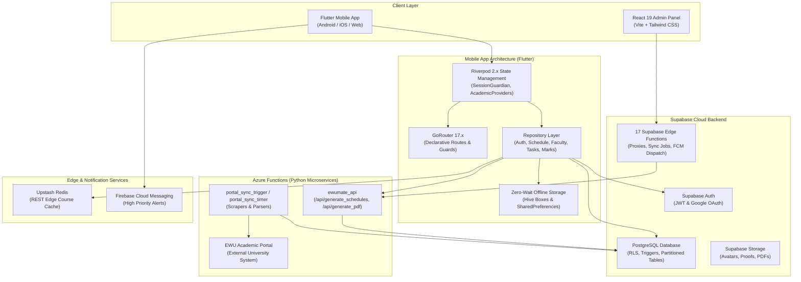

# EWUmate — Production Build
**The Definitive Academic Companion for East West University Students**

**Package:** `com.rxxeron.ewumate`  
**Version:** `1.1.16+46`  
**Target Platform:** Android SDK 36 (minSdk 21) | iOS | Web | Windows (Disabled)  
**Primary Stack:** Flutter 3.27+ | Dart 3.x | Supabase (PostgreSQL + Auth + Edge Functions) | Azure Functions (Python) | Upstash Redis | React 19 (Admin)


---

## Table of Contents

1. [Executive Summary & System Overview](#1-executive-summary--system-overview)
2. [Architecture & Component Diagram](#2-architecture--component-diagram)
3. [End-to-End Data Flows](#3-end-to-end-data-flows)
4. [Tech Stack & Architecture Matrix](#4-tech-stack--architecture-matrix)
5. [Project Structure & Directory Rationale](#5-project-structure--directory-rationale)
6. [Prerequisites & Environment Setup](#6-prerequisites--environment-setup)
7. [Configuration & Environment Variables (.env)](#7-configuration--environment-variables-env)
8. [Getting Started & Local First Run](#8-getting-started--local-first-run)
9. [Development Workflows, Build Commands & Code Style](#9-development-workflows-build-commands--code-style)
10. [Testing Strategy & Test Execution](#10-testing-strategy--test-execution)
11. [Application Entry Point (`main.dart` & Bootloader)](#11-application-entry-point-maindart--bootloader)
12. [Screen-by-Screen Documentation (23 Screens)](#12-screen-by-screen-documentation-23-screens)
13. [Core Services Architecture (11 Services)](#13-core-services-architecture-11-services)
14. [State Management & Riverpod Providers](#14-state-management--riverpod-providers)
15. [Data Models & View Models](#15-data-models--view-models)
16. [Repository Layer Architecture](#16-repository-layer-architecture)
17. [Declarative Navigation & Route Guards (GoRouter)](#17-declarative-navigation--route-guards-gorouter)
18. [Azure Functions Microservices & API Reference](#18-azure-functions-microservices--api-reference)
19. [Supabase Backend Architecture (DB, Edge Functions, Triggers, RLS)](#19-supabase-backend-architecture-db-edge-functions-triggers-rls)
20. [Maintenance & Automation Scripts (`scripts/`)](#20-maintenance--automation-scripts-scripts)
21. [Firebase Cloud Messaging & Push Alerts](#21-firebase-cloud-messaging--push-alerts)
22. [Native Android Integration (Jetpack Glance, Permissions)](#22-native-android-integration-jetpack-glance-permissions)
23. [React Admin Control Panel](#23-react-admin-control-panel)
24. [Design System, Sora Typography & Theme Tokens](#24-design-system-sora-typography--theme-tokens)
25. [Offline-First Architecture & Zero-Wait Entry Engine](#25-offline-first-architecture--zero-wait-entry-engine)
26. [Security Architecture & Privacy Safeguards](#26-security-architecture--privacy-safeguards)
27. [Build Automation, CI/CD & Deployment Guide](#27-build-automation-cicd--deployment-guide)
28. [Monitoring, Telemetry & Rollback Procedures](#28-monitoring-telemetry--rollback-procedures)
29. [Key Architectural Patterns](#29-key-architectural-patterns)
30. [Troubleshooting & Common Pitfalls](#30-troubleshooting--common-pitfalls)
31. [Contributing & Code Sync Protocol](#31-contributing--code-sync-protocol)
32. [License & Credits](#32-license--credits)

---

## 1. Executive Summary & System Overview

**EWUmate** is a production-grade, multi-tier academic assistant platform built specifically for East West University (EWU) students, faculty, and administrators. 

The system couples a high-performance, cross-platform Flutter client with an offline-first caching layer (Hive multi-box storage and SharedPreferences), a real-time PostgreSQL backend on Supabase (featuring Row-Level Security, Edge Functions, and database triggers), serverless Python microservices on Microsoft Azure Functions for heavy compute (combinatorial routine generation, university portal scraping, and PDF report synthesis), an edge Redis cache on Upstash for zero-latency course lookups, and a React 19 web administration dashboard.

The application consumes raw university portal schedules, grade sheets, and academic bulletins, normalizes course loads, and delivers real-time timetable alerts, automated conflict-free routine planning, degree audit simulations, faculty directories with office hour crowdsourcing, and instant academic cover sheet creation.

---

## 2. Architecture & Component Diagram

EWUmate is structured into 5 cohesive tiers designed for extreme resilience, high performance, and zero client-side credential exposure:

1. **Client Tier**: Flutter mobile application (Android/iOS/Web) and React 19 Admin Panel.
2. **State & Offline Tier**: Riverpod 2.x reactive providers, GoRouter navigation guards, and Hive Zero-Wait offline boxes.
3. **Cloud Gateway & Compute Tier**: Azure Functions Python microservices executing schedule permutations, portal scraping, and PDF generation.
4. **Data & Auth Tier**: Supabase PostgreSQL featuring Row Level Security (RLS), Supabase Auth (Google OAuth & JWT), Supabase Storage, and Deno Edge Functions.
5. **Edge Caching & Notification Tier**: Upstash Redis REST cache and Firebase Cloud Messaging (FCM).



---

## 3. End-to-End Data Flows

### 3.1 Client Bootstrapping & Zero-Wait Entry
1. `main()` initiates `_bootloader()` in `lib/main.dart`.
2. `CacheService.init()` loads Hive boxes (`profile_box`, `routine_box`, `academic_box`) into memory. The app renders Frame 1 instantly without awaiting network responses.
3. Concurrently, `Firebase.initializeApp()` configures FCM, and `SupabaseConfig.initialize()` loads `.env` variables and sets up `Supabase.instance`.
4. `SessionGuardian` inspects the active session: valid sessions proceed directly to `/dashboard`, unauthenticated sessions route to `/login`, and semester-end transitions route to the Grade Blocker (`/results/grade-entry`).

### 3.2 Schedule Permutation & Routine Generation
1. Student selects candidate courses and preferences (e.g., preferred time slots, free days, avoiding specific instructors) in `lib/features/schedule/`.
2. `AzureFunctionsService.generateSchedules()` dispatches an HTTP POST request to `/api/generate_schedules` with the user's Supabase JWT.
3. The Azure Python worker verifies the JWT, checks that `body.user_id == jwt.sub`, runs a combinatorial backtracking algorithm against the active term's course catalog (`courses_{semester}`), and returns valid, non-overlapping schedules with generation metrics.

### 3.3 Portal Scraping & Smart Diff Synchronization
1. Automated CRON jobs (`portal_sync_timer`) or administrative actions (`portal_sync_trigger`) query the university portal.
2. The scraper bypasses captchas, extracts updated sections, instructor allocations, and room assignments.
3. Data is sanitized and upserted into Supabase via `courses_sync_service.py`. Upstash Redis cache keys are invalidated to ensure all mobile clients instantly see fresh course capacity numbers.

---

## 4. Tech Stack & Architecture Matrix

| Layer | Technology | Version | Purpose |
|---|---|---|---|
| **Mobile Framework** | Flutter | `>=3.27.0` | Cross-platform client framework |
| **Language** | Dart | `>=3.0.0 <4.0.0` | Strongly typed client code |
| **State Management** | Riverpod | `^2.5.1` | Reactive state, dependency injection, and code generation |
| **Declarative Router** | GoRouter | `^17.5.0` | Declarative routing, deep linking, and navigation guards |
| **Local Cache** | Hive | `^2.2.3` | Zero-Wait NoSQL key-value caching and offline mutation queue |
| **Backend as a Service** | Supabase Flutter | `^2.17.2` | Authentication, PostgreSQL database, Realtime, Storage |
| **Cloud Microservices** | Azure Functions | Python 3.10/3.11 | High-compute routine generation, portal scraping, ReportLab PDF |
| **Edge Cache** | Upstash Redis | REST API | Distributed course catalog caching and fast key-value lookups |
| **Push Notifications** | Firebase Messaging | `^16.7.0` | High-priority background class reminders and announcements |
| **Native Android** | Jetpack Glance | Android SDK 36 | Android launcher home screen widget (`ScheduleWidgetProvider.kt`) |
| **Admin Panel** | React / Vite | React 19, TS | Web administration dashboard for content moderation and portal sync |
| **Styling & UI** | Tailwind CSS / Glass Kit | Custom | Glassmorphism surfaces, Sora typography, shimmer loading states |

---

## 5. Project Structure & Directory Rationale

```
ewumate_production_build/
├── .github/
│   └── workflows/
│       ├── build-android.yml         # CI/CD: Release APK & AAB automated build
│       └── deploy-admin.yml          # CI/CD: React Admin deployment to GitHub Pages
├── admin_panel/                      # React 19 administrative web application
│   ├── src/                          # Admin modules (22 moderation and monitoring panels)
│   └── package.json                  # Node dependencies for admin dashboard
├── azure_functions/                  # Serverless Python microservices
│   ├── ewumate_api/                  # Core API handler (schedule gen, PDF, advising)
│   │   ├── services/                 # Auth, schedule, scraper, PDF, and calendar services
│   │   ├── function.json             # HTTP route binding: route="{action}"
│   │   └── __init__.py               # Action dispatcher and JWT validator
│   ├── portal_sync_timer/            # Scheduled CRON scraper worker
│   ├── portal_sync_trigger/          # HTTP triggered scraper endpoint
│   └── host.json                     # Azure Functions ExtensionBundle configuration
├── docs/                             # Project documentation library
│   ├── ARCHITECTURE.md               # 5-tier architecture and data flows
│   ├── CONFIGURATION.md              # Complete environment variables and defaults
│   ├── GETTING-STARTED.md            # Installation, prerequisites, and first run
│   ├── DEVELOPMENT.md                # Build commands, style guide, and branch conventions
│   ├── TESTING.md                    # Test execution, widget testing, and CI tests
│   ├── API.md                        # Azure Functions endpoints and JSON envelopes
│   ├── DEPLOYMENT.md                 # Production build scripts and store deployment
│   └── knowledge/                    # Live database schema and backend summaries
│       ├── BACKEND_LOGIC.md          # Stored procedures, active triggers, edge functions
│       ├── DATABASE_SCHEMA.md        # Comprehensive table catalog and column definitions
│       ├── MAINTENANCE_SCRIPTS.md    # Database maintenance and automation tools
│       ├── SCHEMA_DIFFERENCES.md     # Production vs local schema sync log
│       └── live_schema_dump.json     # Complete JSON schema extraction
├── lib/                              # Flutter client application root
│   ├── main.dart                     # App entry point, bootloader, HTTP overrides
│   ├── firebase_options.dart         # Generated Firebase configuration
│   ├── core/                         # Infrastructure shared across all features
│   │   ├── config/                   # AppConfig and environment readers
│   │   ├── constants/                # App constants, API routes, onboarding steps
│   │   ├── models/                   # 22 Domain models + View models
│   │   ├── providers/                # SessionGuardian and global Riverpod providers
│   │   ├── repositories/             # 13 Repositories encapsulating network & cache
│   │   ├── router/                   # AppRouter (GoRouter navigation tree)
│   │   ├── services/                 # 11 Core services (Cache, Redis, Azure, FCM, etc.)
│   │   ├── theme/                    # Color tokens, dark theme, and typography
│   │   ├── utils/                    # Date formatters, validators, and helpers
│   │   └── widgets/                  # MainShell, animations, glassmorphism components
│   └── features/                     # Domain modules organized by user journey
│       ├── advising/                 # Pre-advising, routine drafts, conflict solver
│       ├── auth/                     # Login, register, forgot password, check auth
│       ├── course_browser/           # Paginated course offering explorer
│       ├── dashboard/                # Central hub, countdown cards, schedule timeline
│       ├── faculty_directory/        # Faculty profiles, reviews, office hours
│       ├── notifications/            # Push notifications inbox and reminder settings
│       ├── onboarding/               # Profile setup, student ID formatting, tour
│       ├── profile/                  # Account settings, feedback, developer support
│       ├── results/                  # Transcripts, grade entry, and grade blocker
│       ├── schedule/                 # 2-week schedule viewer, makeup classes
│       ├── semester_progress/        # Target SGPA simulator, quiz strategies, marks
│       ├── services/                 # Cover page generator, faculty assignments, portal sync
│       ├── study_vault/              # Note sharing, past papers, Google Drive upload
│       ├── tasks/                    # Student assignment manager with offline queue
│       └── tutorials/                # Categorized YouTube onboarding videos
├── scripts/                          # Python & SQL maintenance and automation scripts
│   ├── check_rls_live.py             # Verifies RLS policies on all Supabase tables
│   ├── check_db_schema.py            # Compares live tables against catalog definition
│   ├── extract_live_schema.py        # Dumps live database structure to JSON
│   ├── run_cleanup.py                # Purges orphaned test data and dangling sessions
│   ├── sync_faculty_directory.py     # Scrapes and synchronizes EWU faculty directory
│   ├── parse_bulletin.py             # Parses academic course catalog from PDF
│   └── populate_course_metadata.py   # Populates course prerequisites and credit values
├── supabase/                         # Supabase backend definitions
│   ├── db_catalog/                   # Trigger definitions and SQL functions
│   ├── functions/                    # 17 Deno Edge Functions (sync-schedule, alert-scheduler)
│   └── migrations/                   # Version-controlled database migration scripts
├── test/                             # Flutter test suite (widget and unit tests)
├── build_production_apk.bat          # Windows batch script for release APK compilation
├── pubspec.yaml                      # Flutter dependencies and asset registrations
└── analysis_options.yaml             # Dart analyzer and linting rules
```

---

## 6. Prerequisites & Environment Setup

Verify that your local development workstation satisfies the following requirements:

- **Flutter SDK**: `Flutter >= 3.27.0` (channel `stable`)
- **Dart SDK**: `>= 3.0.0 < 4.0.0`
- **Java Development Kit**: `Java 17` (e.g., Eclipse Temurin 17 or OpenJDK 17). *Crucial: Java 17 is strictly enforced in Gradle builds and CI pipelines.*
- **Android Studio & SDK**: Android SDK Platform 34 or 36, Android SDK Command-line Tools, and Android Build-Tools `34.0.0` / `35.0.0`.
- **Node.js**: `Node.js >= 20.0.0` (required for React admin panel development).
- **Python**: `Python 3.10+` or `3.11` (required for local Azure Functions execution and maintenance scripts).

Validate tools via terminal:
```bash
flutter doctor -v
java -version
node --version
python --version
```

---

## 7. Configuration & Environment Variables (.env)

The application resolves configuration settings at runtime using `flutter_dotenv`. Place a `.env` file at the root of `ewumate_production_build/`:

### Environment Variable Reference

| Variable | Required | Default / Fallback | Description |
|---|---|---|---|
| `SUPABASE_URL` | **Required** | `https://jwygjihrbwxhehijldiz.supabase.co` | Supabase project endpoint for Auth, Realtime, and PostgreSQL. |
| `SUPABASE_ANON_KEY` | **Required** | Embedded Public Anon JWT | Anonymous public API token for client-side Supabase requests. |
| `AZURE_FUNCTION_URL` | **Required** | `https://ewumate-parser.azurewebsites.net` | Base URL for deployed Azure Functions microservices. |
| `GOOGLE_WEB_CLIENT_ID` | **Required** | `561956344734-ulqeqls...` | OAuth 2.0 Web Client ID registered in Google Cloud Console. |
| `GOOGLE_ANDROID_CLIENT_ID` | Optional | `None` | Android OAuth 2.0 Client ID for native Google Play services. |
| `UPSTASH_REDIS_REST_URL` | Optional | `None` | Upstash Redis REST endpoint for edge course catalog caching. |
| `UPSTASH_REDIS_REST_TOKEN` | Optional | `None` | Authentication bearer token for Upstash Redis REST queries. |

### Sample `.env` Template
```env
SUPABASE_URL=https://jwygjihrbwxhehijldiz.supabase.co
SUPABASE_ANON_KEY=eyJhbGciOiJIUzI1NiIsInR5cCI6...
AZURE_FUNCTION_URL=https://ewumate-parser.azurewebsites.net
GOOGLE_WEB_CLIENT_ID=561956344734-ulqeqls9u4h1hmpec41l9lufk336a9ga.apps.googleusercontent.com
GOOGLE_ANDROID_CLIENT_ID=your_android_client_id.apps.googleusercontent.com
UPSTASH_REDIS_REST_URL=https://your-database.upstash.io
UPSTASH_REDIS_REST_TOKEN=your_upstash_bearer_token
```

> [!IMPORTANT]
> The mobile client binary contains **zero administrative secrets**. `SUPABASE_SERVICE_ROLE_KEY` and database passwords must **never** be included in the client `.env`. They are restricted exclusively to Azure Function App Settings and GitHub Actions Secrets.

---

## 8. Getting Started & Local First Run

### Step 1: Clone Repository
```bash
git clone https://github.com/your-org/ewumate.git
cd ewumate/ewumate_production_build
```

### Step 2: Configure Environment
```bash
cp .env.example .env
# Open .env and insert your active API keys
```

### Step 3: Install Flutter Packages
```bash
flutter pub get
```

### Step 4: Run Code Generator (If Required)
If Riverpod annotations, Freezed models, or json_serializable schemas have changed:
```bash
dart run build_runner build --delete-conflicting-outputs
```

### Step 5: Launch Application
```bash
# Launch on attached emulator or USB-connected Android device
flutter run

# Or run in Google Chrome for responsive web inspection
flutter run -d chrome
```

---

## 9. Development Workflows, Build Commands & Code Style

### Essential Build & CLI Commands

| Command | Purpose |
|---|---|
| `flutter pub get` | Installs dependencies declared in `pubspec.yaml` |
| `flutter run` | Boots interactive debug mode with Hot Reload (`r`) and Hot Restart (`R`) |
| `flutter run --release` | Runs optimized release build on a connected device |
| `dart run build_runner watch --delete-conflicting-outputs` | Continuously watches and generates `*.g.dart` files on save |
| `flutter analyze` | Runs Dart static analysis enforcing rules in `analysis_options.yaml` |
| `dart format --line-length 120 .` | Formats all Dart files to project standard |
| `flutter test` | Executes the unit and widget test suite |
| `flutter build apk --release --no-tree-shake-icons` | Compiles production Android APK preserving all icon glyphs |
| `flutter build appbundle --release` | Compiles Android App Bundle (`.aab`) for Google Play Console |
| `build_production_apk.bat` | One-click Windows batch script for building production release APK |

### Code Style Guidelines
- **Const Constructors**: Always use `const` widgets wherever tree values are immutable.
- **Logging**: Do not use raw `print()` or `debugPrint()` in production logic; use `package:logging`.
- **Layer Isolation**: UI widgets must never query Supabase directly; all data must flow through Riverpod providers (`lib/core/providers/`) and repositories (`lib/core/repositories/`).
- **Null Safety**: Maintain strict null-safety; avoid force-unwrapping operators (`!`) unless guaranteed by guard conditions.

---

## 10. Testing Strategy & Test Execution

EWUmate employs `flutter_test` along with Riverpod `ProviderScope` overrides to ensure high stability across offline and network states.

### Running Tests
```bash
# Run the complete test suite
flutter test

# Run a specific test file
flutter test test/widget_test.dart

# Run tests with verbose expanded output
flutter test --reporter expanded

# Generate test coverage report
flutter test --coverage
```

### Writing Widget Tests with Mock Providers
```dart
import 'package:flutter_test/flutter_test.dart';
import 'package:flutter_riverpod/flutter_riverpod.dart';
import 'package:ewumate/main.dart';

void main() {
  testWidgets('Application boots to splash screen without exceptions', (WidgetTester tester) async {
    await tester.pumpWidget(
      const ProviderScope(
        child: MyApp(),
      ),
    );
    await tester.pumpAndSettle();
    expect(find.byType(MyApp), findsOneWidget);
  });
}
```

---

## 11. Application Entry Point (`main.dart` & Bootloader)

`lib/main.dart` coordinates critical bootstrap steps before mounting the widget tree:

1. **`MyHttpOverrides`**: Configures custom HTTP security overrides for university networks with restrictive SSL gateways.
2. **`_bootloader(cache)`**:
   - `CacheService.init()`: Opens all Hive storage boxes.
   - `Firebase.initializeApp()`: Bypassed on Web to prevent JS interop crashes; initialized on native Android/iOS.
   - `SupabaseConfig.initialize()`: Parses `.env`, configures Supabase client with anon keys.
3. **`SessionGuardian`**: Continuously tracks Supabase session state, automatically handles token refresh, and coordinates with `GoRouter`.
4. **`AppUpdateService.checkForUpdate()`**: Informs the user if a mandatory update has been released on the Google Play Store.
5. **Crash Shield**: Injects a custom `ErrorWidget.builder` presenting a branded, graceful error screen (`#071426`) rather than the default Flutter red screen.

---

## 12. Screen-by-Screen Documentation (23 Screens)

### 1. CheckAuthScreen (`features/auth/check_auth_screen.dart`)
- **Role**: Gatekeeper splash screen.
- **Logic**: Inspects Hive cached credentials for instant routing. If authenticated and active term has ended, evaluates `requiresGradeEntryProvider`. Routes to `/dashboard`, `/results/grade-entry`, `/onboarding`, or `/login`.

### 2. LoginScreen (`features/auth/login_screen.dart`)
- **Role**: Authentication portal.
- **UI**: EWU campus backdrop, glassmorphic input cards, Google OAuth button.
- **Backend**: Calls `Supabase.instance.client.auth.signInWithPassword()` or native Google Sign-In with ID token exchange.

### 3. RegisterScreen (`features/auth/register_screen.dart`)
- **Role**: Student registration.
- **UI**: Interactive form with real-time password strength and email regex verification (`@ewubd.edu` or personal emails).
- **Deep Linking**: Handles `ewumate://login-callback` for confirmation.

### 4. ForgotPasswordScreen & ResetPasswordScreen (`features/auth/`)
- **Role**: Password recovery flow.
- **Backend**: Calls Supabase `resetPasswordForEmail()` and deep links to `ResetPasswordScreen`.

### 5. OnboardingScreen (`features/onboarding/`)
- **Role**: Sequential setup for new students.
- **Steps**:
  1. Profile setup (enforces Student ID format: `XXXX-X-XX-XXX`).
  2. Program selection (department & curriculum picker).
  3. Course history (records past completed courses and baseline CGPA).
  4. Welcome Tour (feature spotlight).

### 6. DashboardScreen (`features/dashboard/dashboard_screen.dart`)
- **Role**: Main application control center.
- **UI**: Dynamic time-of-day Lottie sky header, next class countdown timer, daily class timeline, overdue assignment alerts, administrative announcement carousel, quick action grid.
- **State**: Aggregates `DashboardController`, `scheduleProvider`, and `tasksProvider`.

### 7. ScheduleScreen (`features/schedule/`)
- **Role**: Routine viewer.
- **Features**: 2-week schedule tab switcher, day filter chips, room and faculty badges, makeup class sheet (`AddManualClassSheet`).

### 8. SemesterProgressScreen (`features/semester_progress/`)
- **Role**: Real-time term grade tracker.
- **Features**: Current letter grade projections, mid/final assessment breakdown, live SGPA simulator, dynamic quiz aggregation strategies (Sum Top N, Average, Sum All).

### 9. SemesterSummaryScreen (`features/semester_progress/`)
- **Role**: Historical academic performance.
- **UI**: Interactive CGPA dial gauge, grade distribution charts, scholarship eligibility calculator (Medha Lalon, Dean's List, 100% Merit).

### 10. TasksScreen (`features/tasks/`)
- **Role**: Assignment and task manager.
- **Features**: Tabs for Upcoming, Completed, and Missed deadlines. Supports local reminders and an offline optimistic mutation queue.

### 11. ResultsScreen (`features/results/`)
- **Role**: Official transcript & grade entry blocker.
- **Logic**: Blocks dashboard navigation if the active semester has finished and student has unfinalized course grades, ensuring CGPA calculations stay accurate.

### 12. AdvisingScreen (`features/advising/`)
- **Role**: Pre-advising routine builder.
- **Features**: Course multi-selector, combinatorial routine solver powered by Azure Functions, routine conflict highlighter.
- **Privacy**: Protected by `FLAG_SECURE` (`ScreenProtectionService`) to prevent screenshotting sensitive advising data.

### 13. DegreeProgressScreen (`features/advising/`)
- **Role**: Degree audit and graduation progress.
- **Features**: Visual progress bars across Core, Elective, GED, and Free Elective credits. Dynamically adapts to curriculum changes (e.g. BBA 123 vs 130 credit requirements).

### 14. CourseBrowserScreen (`features/course_browser/`)
- **Role**: Course catalog explorer.
- **Features**: Paginated search across `courses_{semester}`, department chips, expandable section cards displaying real-time seat capacity, timing, and instructor initials.

### 15. FacultyDirectoryScreen (`features/faculty_directory/`)
- **Role**: Faculty master directory.
- **Features**: Searchable directory by name, department, or initials. Details screen includes office room badge, email, active courses, office hours, and student reviews.

### 16. ServicesScreen (`features/services/`)
- **Role**: Academic utilities portal.
- **Features**: 2-column utility launcher linking to Cover Page Generator, Faculty Assignment checker, Faculty List PDF download, and Portal Sync.

### 17. CoverPageScreen (`features/services/cover_page_screen.dart`)
- **Role**: University assignment cover sheet generator.
- **Templates**: 6 standard templates (Assignment, Lab Report, Physics Lab, Group Project, Term Paper, MPS Assignment). Auto-populates faculty names and student info; renders instant PDF previews.

### 18. PortalSyncScreen (`features/services/portal_sync_screen.dart`)
- **Role**: University portal synchronization.
- **State Machine**: 6-step wizard (Connecting, Auth, Data Extraction, Diff Review, Merge). Preserves custom attendance and notes while updating official enrollment data.

### 19. FacultyAssignmentScreen (`features/services/`)
- **Role**: Crowdsourced faculty-course mapping.
- **Features**: Multi-step submission wizard enabling students to upload classroom photos or advising slips to map unassigned course sections.

### 20. StudyVaultScreen (`features/study_vault/`)
- **Role**: Academic resource repository.
- **Features**: Filterable archive of lecture slides, question banks, and notes. Resumable Google Drive uploads via Supabase Edge Functions with SHA-256 deduplication.

### 21. NotificationsScreen (`features/notifications/`)
- **Role**: Notification inbox & alarm configuration.
- **Features**: History of push notifications, `ReminderSettingsScreen` allowing students to customize class alarm offsets (15m, 30m, 1h).

### 22. ProfileScreen (`features/profile/`)
- **Role**: Student identity and settings.
- **Features**: Profile picture uploader, academic details, bug feedback thread (`FeedbackScreen`), and developer support (`SupportDeveloperScreen` via bKash/Nagad).

### 23. TutorialsScreen (`features/tutorials/`)
- **Role**: User guides and video tutorials.
- **UI**: Embedded YouTube walkthroughs categorized by feature.

---

## 13. Core Services Architecture (11 Services)

1. **`CacheService`** (`lib/core/services/cache_service.dart`): Manages multi-box Hive offline caching (`auth_box`, `routine_box`, `profile_box`, `academic_box`) and provides the foundation for Zero-Wait cold starts.
2. **`RedisService`** (`lib/core/services/redis_service.dart`): High-speed REST edge client for Upstash Redis used for instant course catalog reads and low-latency cache invalidations.
3. **`SyncService`** (`lib/core/services/sync_service.dart`): Network-aware mutation manager. Enqueues offline edits into a persistent FIFO queue and flushes them to Supabase upon reconnection.
4. **`PortalService`** (`lib/core/services/portal_service.dart`): Handles university portal authentication, captcha solving, and structured grade/routine extraction.
5. **`AzureFunctionsService`** (`lib/core/services/azure_functions_service.dart`): Authenticated HTTP gateway connecting the mobile client to Azure serverless endpoints (`/api/generate_schedules`, `/api/generate_pdf`, etc.).
6. **`FCMService`** (`lib/core/services/fcm_service.dart`): Initializes Firebase Cloud Messaging, configures high-priority Android notification channels, and binds device tokens to user profiles.
7. **`ScreenProtectionService`** (`lib/core/services/screen_protection_service.dart`): Controls native `FLAG_SECURE` window flags via platform channels to block screenshots on sensitive screens (Advising, Results).
8. **`StorageService`** (`lib/core/services/storage_service.dart`): Handles multi-part file uploads (profile avatars, proof attachments) to Supabase Storage buckets.
9. **`AppUpdateService`** (`lib/core/services/app_update_service.dart`): Queries Play Store version metadata on launch and displays update dialogs.
10. **`TutorialService`** (`lib/core/services/tutorial_service.dart`): Tracks feature spotlight overlays and onboarding tutorial completion flags.
11. **`AppConfig`** (`lib/core/config/supabase_config.dart`): Central environment configuration reader that reads `flutter_dotenv` variables with fallback defaults.

---

## 14. State Management & Riverpod Providers

EWUmate uses Riverpod 2.x for compile-safe, reactive state management:

- **`sessionGuardian`**: Listens to Supabase Auth state, proactively triggers JWT refreshes, and signals GoRouter redirects.
- **`academicProviders`**: Cluster of providers managing active semester metadata, enrolled course sections, weekly timetable grids, and live CGPA calculations.
- **`featureFlagProvider`**: Reads remote dynamic feature flags from Supabase `app_config` (e.g., selectively disabling portal sync during university maintenance).
- **`connectivityProvider`**: Emits real-time online/offline network connectivity streams, triggering `SyncService` queue flushes.
- **`profileProvider`**: Offline-first provider returning cached Hive profile data instantly while initiating a background fetch for updates.
- **`requiresGradeEntryProvider`**: Evaluates whether the active semester has ended and student has un-entered grades, activating the grade blocker guard.

---

## 15. Data Models & View Models

| Model | File | Primary Fields | Purpose |
|---|---|---|---|
| `ActiveSemester` | `active_semester.dart` | `track`, `currentSemesterCode`, `nextSemesterCode`, `classesStartDate` | Defines active university terms |
| `CourseSection` | `course_section.dart` | `courseCode`, `section`, `faculty`, `room`, `timeSlot`, `capacity` | Individual section offering |
| `Enrollment` | `enrollment.dart` | `id`, `userId`, `semesterCode`, `courseCode`, `sectionId`, `status` | Maps student to section |
| `Profile` | `profile.dart` | `id`, `studentId`, `fullName`, `cgpa`, `totalCreditsEarned`, `track` | Core user identity and stats |
| `Faculty` | `faculty.dart` | `id`, `name`, `initials`, `department`, `designation`, `room` | Faculty directory entry |
| `FacultyOfficeHour` | `faculty_office_hour.dart`| `facultyId`, `day`, `startTime`, `endTime`, `room` | Verified office hour slots |
| `FacultyReview` | `faculty_review.dart` | `facultyId`, `userId`, `rating`, `gradingCriteria`, `comment` | Multi-criteria student review |
| `GradeScale` | `grade_scale.dart` | `grade`, `point`, `minScore`, `policy` | University letter-to-GPA mapping |
| `SavedSchedule` | `saved_schedule.dart` | `id`, `userId`, `semester`, `sectionsJson`, `combinationIndex` | Pre-advising routine drafts |
| `ScheduleException`| `schedule_exception.dart`| `courseCode`, `date`, `isCancelled`, `isMakeup`, `newRoom` | Class cancellations & makeups |
| `Task` | `task.dart` | `id`, `userId`, `title`, `dueDate`, `isCompleted`, `courseCode` | Student assignment todo item |
| `CourseMetadata` | `course_metadata.dart` | `code`, `name`, `creditVal`, `prerequisites`, `equivalentCode` | Global curriculum catalog |
| `CalendarEvent` | `calendar_event.dart` | `date`, `title`, `isHoliday`, `semesterCode` | Academic calendar dates |
| `Notification` | `notification.dart` | `id`, `userId`, `title`, `body`, `isRead`, `createdAt` | Push alert history record |
| `Program` | `program.dart` | `code`, `name`, `totalCreditsRequired`, `department` | Degree curriculum model |
| `SemesterSummary`| `semester_summary.dart`| `userId`, `semesterCode`, `sgpa`, `creditsCompleted`, `termGpa` | Historical term performance |
| `SemesterCourseMarks`| `semester_course_marks.dart`| `userId`, `courseCode`, `midScore`, `finalScore`, `quizzesJson` | Granular mark tracker |

---

## 16. Repository Layer Architecture

1. **`AuthRepository`**: Coordinates Supabase session tokens, Google OAuth, and password recovery.
2. **`ProfileRepository`**: Manages user profiles, avatar uploads, and offline caching in `profile_box`.
3. **`ActiveSemesterRepository`**: Fetches active terms and semester tracks; caches to `academic_box`.
4. **`CourseRepository`**: Queries `courses_{semester}` tables and Upstash Redis for instant lookups.
5. **`ScheduleRepository`**: Resolves enrolled classes, makeup sessions, and timetable conflicts.
6. **`DashboardRepository`**: Aggregates today's routine, overdue deadlines, and active announcements.
7. **`FacultyRepository`**: Manages faculty profiles, office hours, and review submissions.
8. **`FacultyReviewsRepository`**: Moderation and student review submissions.
9. **`ScholarshipRepository`**: Calculates scholarship eligibility based on CGPA and credit load.
10. **`TaskRepository`**: Implements offline-first task CRUD syncing with Supabase `tasks`.
11. **`NotificationRepository`**: Local Hive and Supabase push notification history.
12. **`OfficeHoursRepository`**: Crowdsourced office hour submissions and verifications.
13. **`ProgressRepository`**: Degree audit evaluations against `programs` requirements.

---

## 17. Declarative Navigation & Route Guards (GoRouter)

Configured in `lib/core/router/app_router.dart`:

- **Root Navigator**: Uses a top-level `GlobalKey<NavigatorState>` (`rootNavigatorKey`).
- **`ShellRoute` Navigation**: Houses primary application tabs (`/dashboard`, `/schedule`, `/tasks`, `/services`, `/profile`) inside `MainShell`, preserving state across tab switches.
- **Route Guards**:
  - `CheckAuthScreen` (`/`): Evaluates authentication status and pending grade blocker states.
  - Grade Blocker Guard: Forces redirection to `/results/grade-entry` when term concludes with unentered grades.
  - Deep Link Callback: Binds `ewumate://login-callback` to `/login-callback`.

---

## 18. Azure Functions Microservices & API Reference

All Azure microservices are routed under `/api/{action}` on `https://ewumate-parser.azurewebsites.net`.

### Endpoints Table

| Method | Endpoint | Description | Auth Required |
|---|---|---|---|
| `POST` | `/api/generate_schedules` | Computes conflict-free routine schedules for selected courses | **Yes** (Supabase JWT) |
| `POST` | `/api/generate_pdf` | Generates assignment cover pages and lab report PDFs | **Yes** (Supabase JWT) |
| `POST` | `/api/generate_snapshot` | Generates downloadable routine PNG/PDF snapshots | No |
| `POST` | `/api/get_advising_courses` | Computes eligible next-term courses based on prerequisites | No |
| `POST` | `/api/parse_calendar` | Parses academic calendar PDF/text into structured events | No |
| `POST` | `/api/switch_semester` | Administrative term rollover and migration trigger | **Yes** (Admin) |
| `POST` | `/api/parse_grade_sheet` | Extracts completed grades from portal grade sheet images/PDFs | No |
| `POST` | `/api/portal_sync_student` | Scrapes student-specific routine from university portal | **Yes** (Supabase JWT) |
| `POST` | `/api/sync_api_courses` | Syncs course offering capacities from official APIs | **Yes** (Admin) |
| `POST` | `/api/portal_sync` | Triggers university portal course scraper | **Yes** (Admin) |
| `POST` | `/api/faculty_sync` | Synchronizes EWU faculty directory profiles and departments | **Yes** (Admin) |

### Sample Payload: Schedule Generation (`POST /api/generate_schedules`)
```json
{
  "user_id": "8f8b8098-b80c-4e46-bb1e-a579da93dfd6",
  "semester": "Spring 2026",
  "courses": ["CSE106", "MAT101", "ENG101"],
  "filters": {
    "free_days": ["Thursday"],
    "time_preference": "morning",
    "avoid_faculties": ["XYZ"]
  }
}
```

---

## 19. Supabase Backend Architecture (DB, Edge Functions, Triggers, RLS)

### 19.1 Database Tables Architecture
- **User & Profiles**: `profiles`, `admin_users`, `fcm_tokens`, `user_semester_states`, `user_drafts`
- **Academic Meta**: `active_semester`, `semesters`, `programs`, `grade_scale`, `scholarship_policies`, `course_metadata`
- **Dynamic Semester Partitions**: `courses_{semester}` (e.g. `courses_spring2026`), `calendar_{semester}`
- **Academic Records**: `enrollments`, `completed_courses`, `semester_summaries`, `semester_course_marks`
- **App Features**: `tasks`, `notifications`, `feedbacks`, `study_materials`, `faculty_reviews`, `faculty_office_hours`, `schedule_exceptions`
- **System**: `sync_jobs`, `scraper_logs`, `app_config`

### 19.2 Edge Functions (17 Functions in `supabase/functions/`)
1. `sync-schedule`: Syncs and caches user schedule templates.
2. `sync-academic-stats`: Calculates CGPA, completed credits, and semester results.
3. `alert-scheduler`: Evaluates upcoming classes and schedules push alerts.
4. `alert-dispatcher`: Dispatches scheduled FCM notifications.
5. `azure-admin-proxy`: Secure proxy connecting the React admin panel to Azure Functions.
6. `admin-auth`: Admin authentication and scoped JWT generation.
7. `admin-purge-user`: GDPR-compliant student data removal.
8. `get-drive-upload-url`: Resumable Google Drive upload URLs for Study Vault.
9. `pdf-parser`: Wraps Python parsing logic for cloud execution.
10. `send-push-notification`: Direct device push messaging.
11. `sync-semester-meta`: Updates global semester metadata on term change.
12. `trigger-processor`: Asynchronous DB trigger event processor.
13. `update-progress`: Recalculates graduation progress against curriculum.
14. `admin-direct-message`: Dispatches in-app support chat replies.
15. `admin-holiday`: Broadcasts campus closure and holiday notices.
16. `broadcast`: Campus-wide push announcements.
17. `create-tables`: Dynamic DDL migration for creating new semester tables.

### 19.3 Row Level Security (RLS) Policies
- `profiles`: `auth.uid() = id` (Students can read/update strictly their own profile).
- `enrollments`: `auth.uid() = user_id` (Private to the authenticated student).
- `study_materials`: Public read access allowed only for items where `status = 'approved'`.
- `scraper_logs` & `sync_jobs`: Restricted exclusively to `service_role`.

---

## 20. Maintenance & Automation Scripts (`scripts/`)

The `scripts/` directory contains tools for database administration and automation:

- **`scripts/check_rls_live.py`**: Audits all live database tables to guarantee Row Level Security is active and policies are enforced.
- **`scripts/check_db_schema.py`**: Compares the production PostgreSQL schema against `docs/knowledge/DATABASE_SCHEMA.md`.
- **`scripts/extract_live_schema.py`**: Extracts the live Supabase schema and exports to `docs/knowledge/live_schema_dump.json`.
- **`scripts/run_cleanup.py`**: Cleans up dangling sessions and orphaned test records.
- **`scripts/sync_faculty_directory.py`**: Scrapes and updates the faculty directory catalog.
- **`scripts/parse_bulletin.py`**: Extracts course definitions, credit weights, and prerequisites from the official EWU Academic Bulletin PDF.
- **`scripts/populate_course_metadata.py`**: Populates the `course_metadata` table with degree curriculum mappings.

---

## 21. Firebase Cloud Messaging & Push Alerts

- **Android Notification Channel**: `ewumate_high_priority_v4` (Importance: High / Urgent).
- **Custom Sound**: Bound to `notification_sound.wav` bundled in Android raw resources.
- **Vibration Pattern**: `[0, 1000, 300, 1000]`.
- **Background Handler**: Registered with `@pragma('vm:entry-point')` in `lib/main.dart` to handle incoming pushes when the app is killed.
- **Token Registration**: Device FCM tokens are synchronized to `fcm_tokens` on authentication.

---

## 22. Native Android Integration (Jetpack Glance, Permissions)

- **Home Screen Routine Widget**: Implemented in native Kotlin via Jetpack Glance (`ScheduleWidgetProvider.kt`), rendering today's classes directly onto the user's home screen launcher.
- **Deep Linking**: Intent filters configured for `ewumate://login-callback`.
- **Android Manifest Permissions**:
  - `android.permission.POST_NOTIFICATIONS`: Push alerts.
  - `android.permission.VIBRATE`: Custom notification vibration patterns.
  - `android.permission.WAKE_LOCK`: Background routine alarms.
  - *Privacy Policy*: `READ_MEDIA_IMAGES` and `READ_MEDIA_VIDEO` are completely removed; modern Android photo pickers are used instead.
- **Compilation Targets**: Compile SDK 36, Target SDK 34, Min SDK 21, Java 17 desugaring enabled in `android/app/build.gradle`.

---

## 23. React Admin Control Panel

Located in `admin_panel/` and built with React 19, TypeScript, Vite, and Tailwind CSS. Connects securely to backend microservices through `azure-admin-proxy`.

### 22 Control Modules
1. **Dashboard**: High-level system vitals, active user metrics, and quick actions.
2. **PortalAutomation**: Manual and automated portal scraper management.
3. **FacultyReviewsModeration**: Review and approve student-submitted faculty evaluations.
4. **ActiveSemester**: Manage tri-semester and bi-semester track dates.
5. **StudyVaultManager**: Review and approve notes, slides, and past papers.
6. **DataQuality**: Detect orphan records and missing course sections.
7. **CalendarEditor**: Edit academic calendars and holiday events.
8. **CoursesList**: Browse and modify section offerings for the active term.
9. **FacultyMaster**: Update faculty directory profiles, rooms, and designations.
10. **OfficeHoursModeration**: Review crowdsourced faculty office hour proofs.
11. **Donations**: View student support donations (bKash/Nagad/Rocket).
12. **Feedbacks**: Manage student bug reports and support inquiry threads.
13. **UserDetails**: Inspect individual student profile states and enrollments.
14. **UsersList**: Paginated user management table.
15. **NotificationsManager**: Compose and broadcast push notifications.
16. **SystemLogs**: View scraper execution logs and system error reports.
17. **AppConfig**: Remote feature flags and global system settings.
18. **EdgeFunctionsMonitor**: Monitor execution metrics for Supabase Edge Functions.
19. **Analytics**: Aggregate student enrollment trends and GPA distributions.
20. **StorageManager**: Inspect Supabase storage usage and cleanup dead files.
21. **FeatureFlags**: Toggle feature availability across app versions.
22. **AdminRoles**: Manage administrative permissions and access levels.

---

## 24. Design System, Sora Typography & Theme Tokens

EWUmate features an immersive, dark glassmorphic design system:

### Color Palette
- `primaryNavy`: `#071426` (Deep canvas)
- `backgroundDark`: `#050E1A` (App background)
- `surfaceNavyBlue`: `#0D2342` (Card surface)
- `primaryCyan`: `#19D9F5` (Accent cyan)
- `secondarySoftBlue`: `#5EA8FF` (Interactive elements)
- `secondaryText`: `#8493A8` (Muted labels)
- `errorRose`: `#F43F5E` (Errors and overdue alerts)
- `successEmerald`: `#10B981` (Completed checkpoints)

### Typography & Motion
- **Font Family**: Google Fonts Sora.
- **Glass Surfaces**: `GlassKit` backdrop blur filters and squircle border radiuses.
- **Animations**: Time-adaptive Lottie sky animations (dawn, midday, twilight, midnight) responding to local campus time.

---

## 25. Offline-First Architecture & Zero-Wait Entry Engine

- **Zero-Wait Entry**: Reads `profile_box` and `routine_box` synchronously on startup. The app renders immediately without displaying blocking spinners.
- **Optimistic UI Updates**: Marking a task as done updates local Hive storage instantly and appends the operation to the offline mutation queue.
- **Auto-Reconnection Sync**: `SyncService` listens to network connectivity changes via `connectivityProvider`, draining pending requests to Supabase upon reconnection.
- **Hive Storage Boxes**: `auth_box`, `academic_box`, `routine_box`, `metadata_box`, `profile_box`, `dashboard_box`, `schedule_box`, `sync_queue_box`, `semester_progress_box`, `notifications_box`, `course_catalog`, `faculty`.

---

## 26. Security Architecture & Privacy Safeguards

- **Zero Client Secrets**: Client bundles contain NO service role keys or database credentials.
- **JWT Verification**: Azure Function microservices enforce JWT verification and confirm that `body.user_id == jwt.sub`.
- **Database RLS**: Every table in Supabase PostgreSQL enforces strict Row Level Security.
- **`FLAG_SECURE` Privacy**: Automatically applied on sensitive screens (Advising, Results) to block screenshots and screen recording.
- **Admin Defense**: The React admin panel communicates exclusively through secure proxy edge functions (`azure-admin-proxy`).

---

## 27. Build Automation, CI/CD & Deployment Guide

### 27.1 Automated Android Build Pipeline (`.github/workflows/build-android.yml`)
Triggered via `workflow_dispatch` on GitHub:
1. Configures JDK 17 using `actions/setup-java@v4`.
2. Configures Flutter stable using `subosito/flutter-action@v2`.
3. Extracts app version from `pubspec.yaml` (e.g. `1.1.16+46`).
4. Injects production secrets from GitHub Repository Secrets (`ENV_FILE`, `KEYSTORE_BASE64`, `KEY_PROPERTIES_BASE64`).
5. Executes release builds:
   ```bash
   flutter build apk --release --no-tree-shake-icons
   flutter build appbundle --release
   ```
6. Uploads release APK and AAB as downloadable workflow artifacts.

### 27.2 Local Windows Build Script (`build_production_apk.bat`)
```bat
@echo off
echo Compiling EWUmate Production APK...
flutter build apk --release --no-tree-shake-icons
echo Build Complete! Output at: build\app\outputs\flutter-apk\app-release.apk
pause
```

### 27.3 Admin Panel Deployment (`.github/workflows/deploy-admin.yml`)
Triggered on push to `main`, `production`, or `testing` when files inside `admin_panel/**` change:
1. Configures Node.js 24 with npm caching.
2. Runs `npm install` and `npm run build` in `admin_panel/`.
3. Deploys static build artifacts to GitHub Pages via `actions/deploy-pages@v4`.

---

## 28. Monitoring, Telemetry & Rollback Procedures

### Telemetry
- **Crash Reporting**: Firebase Crashlytics and Firebase Core (`firebase_options.dart`).
- **Backend Monitoring**: Azure Application Insights tracks function latency, execution counts, and failure rates.
- **Database Health**: Monitored via the Supabase Cloud Management Console (Logs Explorer, Edge Function metrics).

### Rollback Procedures
- **Mobile Client (Google Play)**: Halt staged rollouts in Google Play Console or roll back to the previously published APK/AAB version code.
- **Direct APK Distribution**: Publish prior stable APK release and trigger an in-app update banner via `AppUpdateService`.
- **Admin Panel**: Revert to previous Git commit on `main` branch to trigger immediate GitHub Pages redeployment.
- **Azure Functions**: Roll back deployment slots via Azure CLI (`func azure functionapp publish`).

---

## 29. Key Architectural Patterns

1. **Zero-Wait Entry Pattern**: App boots entirely from local Hive cache boxes, eliminating launch delay.
2. **Grade Blocker Guard**: Enforces required student actions at critical academic milestones.
3. **Optimistic Offline Sync**: UI mutates immediately; background sync queue reconciles with the database once connected.
4. **Adaptive Window Privacy**: Toggles Android `FLAG_SECURE` dynamically based on the active GoRouter route.
5. **Unified Table Lifecycle**: PostgreSQL triggers coordinate data consistency across enrollments and historical records.
6. **Dynamic Semester Partitioning**: Isolates high-frequency course offerings into semester-specific tables (`courses_{semester}`) for fast queries.
7. **Smart Diff Portal Synchronization**: Merges portal data intelligently to preserve user-entered custom marks and attendance notes.

---

## 30. Troubleshooting & Common Pitfalls

- **JDK Incompatibility**: Gradle fails with `Unsupported class file major version`. Ensure `JAVA_HOME` points strictly to JDK 17.
- **Missing `.env` File**: Logs display `[SupabaseConfig] .env load notice`. Ensure `.env` is created at the root of `ewumate_production_build/`.
- **Hive Schema Mismatch**: Clear app storage if models change without a corresponding Hive adapter migration during development.
- **Azure Functions Cold Starts**: Ensure client requests implement exponential backoff retry logic to handle initial cold start latency.
- **Google Sign-In SHA-1 Mismatch**: Verify that your debug and release keystore SHA-1 fingerprints are registered in Google Cloud Console.

---

## 31. Contributing & Code Sync Protocol

To maintain consistency across app channels, adhere to the **Code Sync Protocol**:

1. Create a feature branch from `main`:
   ```bash
   git checkout -b feat/your-feature-name
   ```
2. Implement and test changes inside `ewumate_production_build`.
3. Verify static analysis and tests pass:
   ```bash
   flutter analyze
   flutter test
   ```
4. Submit a Pull Request.
5. Upon approval and merge to `main`, cherry-pick applicable commits to the `ewumate_v2` and `ewumate_pwa` branches.

---

## 32. License & Credits

**Proprietary Software.** © 2026 East West University / Rxxeron. All Rights Reserved.  
Architected, Designed, and Maintained by the **EWUmate Core Engineering Team**.

For administrative inquiries, technical escalations, or security reports, please contact the development team through the in-app developer feedback portal.
