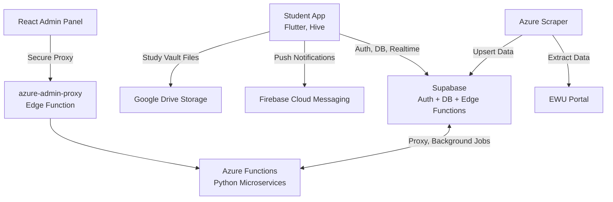

# EWUmate — Production Build
**Academic Companion for East West University Students**

**Package:** `com.rxxeron.ewumate`  
**Version:** `1.1.15+45`  
**Tech:** Flutter 3.x | Dart 3.x | Android SDK 36 | Supabase | Azure Functions


---

## 2. Table of Contents
- [1. Header & Badges](#1-header--badges)
- [2. Table of Contents](#2-table-of-contents)
- [3. Architecture Overview](#3-architecture-overview)
- [4. Tech Stack](#4-tech-stack)
- [5. Project Structure](#5-project-structure)
- [6. Environment Setup & Prerequisites](#6-environment-setup--prerequisites)
- [7. Getting Started](#7-getting-started)
- [8. Application Entry Point (main.dart)](#8-application-entry-point-maindart)
- [9. Screen-by-Screen Documentation](#9-screen-by-screen-documentation)
- [10. Core Services Documentation](#10-core-services-documentation)
- [11. State Management (Riverpod)](#11-state-management-riverpod)
- [12. Data Models](#12-data-models)
- [13. Repository Layer](#13-repository-layer)
- [14. Routing (GoRouter)](#14-routing-gorouter)
- [15. Azure Functions API Reference](#15-azure-functions-api-reference)
- [16. Supabase Backend](#16-supabase-backend)
- [17. Firebase Cloud Messaging](#17-firebase-cloud-messaging)
- [18. Android Native Integration](#18-android-native-integration)
- [19. Admin Panel](#19-admin-panel)
- [20. Design System & Theme](#20-design-system--theme)
- [21. Offline-First Architecture](#21-offline-first-architecture)
- [22. Security](#22-security)
- [23. Build & Deployment](#23-build--deployment)
- [24. Testing](#24-testing)
- [25. Key Architectural Patterns](#25-key-architectural-patterns)
- [26. Troubleshooting](#26-troubleshooting)
- [27. Contributing](#27-contributing)
- [28. License & Credits](#28-license--credits)

---

## 3. Architecture Overview

EWUmate uses a sophisticated 5-layer architecture designed for high availability, security, and performance.

1. **Flutter Mobile App**: The primary client interface. Built with Riverpod for state management, GoRouter for navigation, Hive for offline caching, and Supabase for real-time backend integration.
2. **Azure Functions**: Python-based microservices handling compute-heavy tasks (scraping, schedule generation, PDF creation) and abstracting complex logic away from the client.
3. **Supabase PostgreSQL Backend**: The core database featuring Row Level Security (RLS) for data privacy, Edge Functions for proxying/automation, and triggers for automated data lifecycle management.
4. **React Admin Panel**: A web interface for administrators to manage content, moderate reviews, and monitor system health.
5. **Automation Scripts**: Scripts for ongoing maintenance, semester rollover, and bulk data operations.



---

## 4. Tech Stack

| Layer | Technology | Purpose |
|-------|------------|---------|
| **Frontend Mobile** | Flutter 3.x | Cross-platform UI toolkit |
| **State Management** | Riverpod 2.x | Reactive state and dependency injection |
| **Routing** | GoRouter 14.x | Declarative routing with deep links |
| **Local Storage** | Hive | Offline-first NoSQL database for Zero-Wait entry |
| **Backend as a Service** | Supabase Flutter | Authentication, PostgreSQL, Realtime subscriptions, Edge Functions |
| **Push Notifications** | Firebase Core / Messaging | Cloud messaging for alerts and reminders |
| **Monetization** | Google Mobile Ads | In-app advertising |
| **PDF Generation** | ReportLab PDF (Azure) | Generating cover pages and assignment PDFs |
| **Authentication** | Google Sign-In | Native OAuth integration for quick login |
| **Native Android** | Home Widget | Jetpack Glance schedule widget on home screen |
| **UI Components** | Glass Kit, Shimmer, Lottie | Glassmorphism, loading states, complex vector animations |
| **Typography** | Google Fonts (Sora) | Brand-consistent font loading |

---

## 5. Project Structure

```
lib/
├── main.dart
├── firebase_options.dart
├── core/
│   ├── config/ 
│   │   ├── app_config.dart
│   │   └── build_config.dart
│   ├── constants/ 
│   │   ├── api_constants.dart
│   │   ├── app_constants.dart
│   │   └── onboarding_steps.dart
│   ├── models/ (22 domain models + 8 view models)
│   ├── providers/ (7 provider files)
│   ├── repositories/ (13 repositories)
│   ├── router/ 
│   │   └── app_router.dart
│   ├── services/ (9 services)
│   ├── theme/ (3 theme files)
│   ├── utils/ (9 utility files)
│   └── widgets/ 
│       ├── animations/
│       ├── primitives/
│       ├── glass_kit/
│       ├── modals/
│       └── shell/
└── features/
    ├── advising/
    ├── auth/
    ├── course_browser/
    ├── dashboard/
    ├── faculty_directory/
    ├── layout/
    ├── notifications/
    ├── onboarding/
    ├── profile/
    ├── progress/
    ├── results/
    ├── schedule/
    ├── semester_progress/
    ├── services/
    ├── study_vault/
    ├── tasks/
    └── tutorials/
```

---

## 6. Environment Setup & Prerequisites

To build and run the EWUmate production application, ensure your environment meets the following requirements:

- **Flutter SDK**: `3.27.0` or higher
- **Dart SDK**: `>=3.0.0 <4.0.0`
- **Android SDK**: API level 36, `minSdk` 21
- **Java**: Version 17 with desugaring enabled in `build.gradle`
- **Node.js**: 18.x (Required only for React admin panel development)
- **Python**: 3.10+ (Required for scripts & local Azure Functions testing)

**Environment Variables (`.env`)**:
Create a `.env` file in the root directory with the following keys:
```env
SUPABASE_URL=your_supabase_project_url
SUPABASE_ANON_KEY=your_supabase_anon_key
AZURE_FUNCTION_URL=your_azure_functions_base_url
GOOGLE_WEB_CLIENT_ID=your_google_web_client_id
GOOGLE_ANDROID_CLIENT_ID=your_google_android_client_id
```

**Firebase**: Ensure `google-services.json` is placed in `android/app/` for FCM and Analytics.

---

## 7. Getting Started

Follow these steps to run the application locally:

1. **Clone the repository**:
   ```bash
   git clone <repository-url>
   cd ewumate_production_build
   ```
2. **Install Flutter dependencies**:
   ```bash
   flutter pub get
   ```
3. **Configure Environment**:
   Create the `.env` file and populate it with production/staging keys as detailed above.
4. **Firebase Setup**:
   Download `google-services.json` from the Firebase Console and place it in the `android/app/` directory.
5. **Run the App**:
   ```bash
   flutter run
   ```
6. **Build Release Artifacts**:
   - APK: `flutter build apk --release`
   - App Bundle: `flutter build appbundle --release`

---

## 8. Application Entry Point (`main.dart`)

The `main.dart` file bootstraps the EWUmate application with crucial initializations:

- **`MyHttpOverrides`**: A custom HTTP overrides class that bypasses bad certificate issues specifically required for some native platform network calls or restrictive campus networks.
- **Custom `ErrorWidget.builder`**: Replaces the standard red screen of death with a branded, user-friendly crash screen in production using color `#071426`.
- **Parallel Initialization**: Speeds up launch by running critical setups concurrently:
  - `CacheService().init()`: Initializes Hive boxes for Zero-Wait Entry.
  - `Firebase.initializeApp()`: Sets up Firebase Core.
  - `SupabaseConfig.initialize()`: Connects to the Supabase backend.
- **FCM Background Handler Registration**: Sets up the top-level isolate handler for incoming push notifications when the app is terminated.
- **`SessionGuardian` Lifecycle**: Injects the auth monitoring service that proactively refreshes Supabase sessions and routes authenticated users.
- **`AppUpdateService`**: Checks the Google Play Store for mandatory or optional version updates before letting the user proceed.
- **FCM Device Token Binding**: Automatically registers the device's push token with the authenticated user profile in the backend.

---

## 9. Screen-by-Screen Documentation

### 9.1 CheckAuthScreen (`features/auth/check_auth_screen.dart`)
- **Purpose**: Acts as the splash and routing logic gatekeeper.
- **Key UI**: Minimal splash screen with app logo.
- **State Management**: Uses `sessionGuardian` and `profileProvider`.
- **Backend Calls**: Validates Supabase session.
- **Navigation Flow**: Routes seamlessly to `OnboardingScreen`, `ResultsScreen` (grade blocker), or `DashboardScreen`. Uses Hive cached profile for Zero-Wait Entry.

### 9.2 LoginScreen (`features/auth/login_screen.dart`)
- **Purpose**: Authenticates existing users.
- **Key UI**: Email/password fields, Google Sign-In button, EWU campus background image with glassmorphism overlay.
- **State Management**: Local ephemeral state for form validation, `authProvider` for backend calls.
- **Backend Calls**: Supabase `signInWithPassword`, Google OAuth native SDK extraction of `idToken` to Supabase `signInWithIdToken`.
- **Navigation Flow**: On success, redirects to `CheckAuthScreen` to re-evaluate routing.

### 9.3 RegisterScreen (`features/auth/register_screen.dart`)
- **Purpose**: New user account creation.
- **Key UI**: Registration form, dynamic validation feedback.
- **State Management**: `authProvider`.
- **Backend Calls**: Supabase `signUp`.
- **Navigation Flow**: Triggers email verification. Handles deep link callback `ewumate://login-callback` to finalize auth. Avatar upload is intentionally decoupled from signup for speed.

### 9.4 ForgotPasswordScreen & ResetPasswordScreen
- **Purpose**: Password recovery flow.
- **Key UI**: Email entry form, new password entry form.
- **State Management**: Local form state.
- **Backend Calls**: Supabase `resetPasswordForEmail`, `updateUser`.
- **Navigation Flow**: User receives email link, opens app via deep link to `ResetPasswordScreen`.

### 9.5 OnboardingScreen (`features/onboarding/`)
- **Purpose**: Multi-step setup for new users.
- **Key UI**: Welcome page, profile setup, program selection, course history, welcome tour.
- **State Management**: `onboardingControllerProvider`.
- **Backend Calls**: Updates `profiles` table, bulk inserts into `completed_courses`.
- **Navigation Flow**: Sequential stepper. 
  - Profile setup strictly formats Student ID as `XXXX-X-XX-XXX`.
  - Program selection uses a department + academic program picker.
  - Course history allows interactive grade entry for completed courses to establish baseline CGPA.

### 9.6 DashboardScreen (`features/dashboard/dashboard_screen.dart`)
- **Purpose**: Primary home screen acting as the central hub.
- **Key UI**: Hero card (greeting + schedule summary), live class countdown card, daily timeline, overdue task checkpoints, quick action grid, banner tray (admin-controlled).
- **State Management**: `DashboardController` aggregates data from routine, tasks, attendance, and exams.
- **Backend Calls**: Fetches latest announcements, relies heavily on cached offline data.
- **Navigation Flow**: Hub to all other major features.

### 9.7 ScheduleScreen (`features/schedule/`)
- **Purpose**: Class schedule visualization.
- **Key UI**: 2-week schedule viewer, day selector tabs, class cards with room/faculty/time, `AddManualClassSheet`.
- **State Management**: `scheduleProvider`.
- **Backend Calls**: Queries `enrollments` and `schedule_exceptions`.
- **Navigation Flow**: Tabs for Upcoming, Past, and Pending classes. Supports adding manual makeup classes.

### 9.8 SemesterProgressScreen (`features/semester_progress/`)
- **Purpose**: Track ongoing semester academic performance.
- **Key UI**: Course cards grid with current letter grade projections, Midterm/Final assessment breakdowns.
- **State Management**: `CourseMarksController`.
- **Backend Calls**: Updates `semester_course_marks` table.
- **Navigation Flow**: Tapping a course opens `CourseProgressDetailScreen` with tabs for Mid, Final, Quizzes, Attendance. Supports complex quiz strategies (Sum Top N, Average, Sum All) using dynamic JSONB arrays. Live SGPA calculation and Target grade simulator included.

### 9.9 SemesterSummaryScreen
- **Purpose**: High-level academic overview.
- **Key UI**: CGPA dial card, grade distribution charts, academic years timeline, scholarship tier selector (Medha Lalon, Dean's List, Merit 100%).
- **State Management**: `academicProviders`.
- **Backend Calls**: Aggregates `semester_summaries`.

### 9.10 TasksScreen (`features/tasks/`)
- **Purpose**: Student task and assignment management.
- **Key UI**: Tabbed view (Upcoming, Completed, Missed), `AddTaskBottomSheet`.
- **State Management**: `tasksProvider`.
- **Backend Calls**: CRUD on `tasks` table with optimistic updates via Hive queue.
- **Navigation Flow**: Allows creating deadlines with local push reminders. Syncs offline gracefully.

### 9.11 ResultsScreen (`features/results/`)
- **Purpose**: Transcript and final grade viewing.
- **Key UI**: Transcript view with SGPA/CGPA breakdown, `GradeEntryScreen`.
- **State Management**: `resultsProvider`, `requiresGradeEntryProvider`.
- **Backend Calls**: Fetches `completed_courses`.
- **Navigation Flow**: Acts as a mandatory grade blocker when the active semester ends, forcing users to input final grades before accessing the app.

### 9.12 AdvisingScreen (`features/advising/`)
- **Purpose**: Pre-advising and course selection hub.
- **Key UI**: 3 tabs (Courses, Saved Drafts, Generations). Course selection list with section filtering.
- **State Management**: `advisingProvider`.
- **Backend Calls**: Integrates with Azure Functions schedule generator.
- **Navigation Flow**: Detects schedule conflicts. Protected by `FLAG_SECURE` (ScreenProtectionService) during course picking to prevent screenshotting sensitive advising data.

### 9.13 DegreeProgressScreen
- **Purpose**: Visual degree audit.
- **Key UI**: Breakdown by Core, Electives, GED, Free Electives. CGPA hero card with milestones.
- **State Management**: `degreeProgressProvider`.
- **Backend Calls**: Evaluates completed credits against `programs` table requirements.
- **Navigation Flow**: Adapts dynamic BBA graduation rules (123 vs 130 credits) based on admission date.

### 9.14 CourseBrowserScreen (`features/course_browser/`)
- **Purpose**: Explore active and upcoming courses.
- **Key UI**: Infinite scroll pagination, department filter chips, expandable course cards detailing sections, faculty, and capacity.
- **State Management**: `courseBrowserProvider`.
- **Backend Calls**: Queries `courses_{semester}`.

### 9.15 FacultyDirectoryScreen (`features/faculty_directory/`)
- **Purpose**: Searchable directory of EWU faculty.
- **Key UI**: Faculty cards with avatar, designation, room badge. `FacultyDetailsScreen` with tabs (About, Courses, Contact, Office Hours, Reviews).
- **State Management**: `facultyProvider`.
- **Backend Calls**: Queries `faculty`, `faculty_reviews`, `faculty_office_hours`.
- **Navigation Flow**: Allows submitting a faculty review sheet (multi-criteria scorecard) and submitting office hours with proof upload.

### 9.16 ServicesScreen (`features/services/`)
- **Purpose**: Academic utility tools portal.
- **Key UI**: 2-column grid.
- **Navigation Flow**: Routes to Cover Page Generator, Faculty Assignment checker, Faculty List download, Portal Sync.

### 9.17 CoverPageScreen
- **Purpose**: Generates standard assignment cover pages.
- **Key UI**: Select from 6 templates (Assignment, Lab Report, Physics Lab, Group Project, Term Paper, MPS Assignment).
- **State Management**: Local state.
- **Backend Calls**: Auto-fills faculty from `courses_{semester}`. Real-time PDF preview and Azure Functions generation via `generate_pdf`.

### 9.18 PortalSyncScreen
- **Purpose**: Automates data sync from EWU portal.
- **Key UI**: 6-step interactive state machine (Start, Connecting, Connecting 2, Data preview, Data preview 2, Smart diff sync).
- **State Management**: `portalSyncProvider`.
- **Backend Calls**: Triggers `sync-academic-stats` and `sync-schedule` Edge Functions.
- **Navigation Flow**: Preserves user's custom attendance and marks while syncing official schedule and grades.

### 9.19 FacultyAssignmentScreen
- **Purpose**: Student crowdsourcing of faculty-course assignments.
- **Key UI**: 2-step stepper (Course selection → Proof upload).
- **Backend Calls**: Uploads image proof to Supabase storage.

### 9.20 StudyVaultScreen (`features/study_vault/`)
- **Purpose**: Repository for notes, slides, and past papers.
- **Key UI**: Search/filter by course/faculty. Upload workflow. `MyStudyMaterialsScreen`.
- **State Management**: `studyVaultProvider`.
- **Backend Calls**: SHA-256 deduplication, Google Drive resumable upload via Edge Functions.

### 9.21 NotificationsScreen
- **Purpose**: View push notification history.
- **Key UI**: Notification list with mark-as-read functionality. `ReminderSettingsScreen` to toggle offsets (15m, 30m, 1h).
- **State Management**: `notificationsProvider`.
- **Backend Calls**: Local Hive box and Supabase `notifications` table.

### 9.22 ProfileScreen
- **Purpose**: Manage user identity and settings.
- **Key UI**: Profile details, degree stats, app version. `FeedbackScreen` (bug reports with admin threads). `SupportDeveloperScreen` (donations via bKash/Nagad/Rocket).
- **State Management**: `profileProvider`.

### 9.23 TutorialsScreen
- **Purpose**: Help and onboarding videos.
- **Key UI**: Embedded YouTube videos categorized by feature.

---

## 10. Core Services Documentation

### 1. CacheService
- **File Path**: `lib/core/services/cache_service.dart`
- **Purpose**: Hive multi-box caching and offline mutation queue.
- **Key Methods**: `init()`, `getBox()`, `clearAll()`.
- **Integration**: Foundation for Offline-First Architecture.

### 2. SyncService
- **File Path**: `lib/core/services/sync_service.dart`
- **Purpose**: Network-aware replication and auto-drain mutations.
- **Key Methods**: `enqueueMutation(mutation)`, `flushQueue()`, `startListener()`.
- **Integration**: Listens to `connectivityProvider` to flush offline edits.

### 3. PortalService
- **File Path**: `lib/core/services/portal_service.dart`
- **Purpose**: EWU portal scraper, captcha solver, session management.
- **Key Methods**: `login()`, `scrapeRoutine()`, `scrapeGrades()`.
- **Integration**: Used by `PortalSyncScreen` and Azure functions API.

### 4. FCMService
- **File Path**: `lib/core/services/fcm_service.dart`
- **Purpose**: Push notifications, Android channel config, device tokens.
- **Key Methods**: `initFCM()`, `getToken()`, `onMessage()`.
- **Integration**: Binds tokens to `fcm_tokens` table on login.

### 5. ScreenProtectionService
- **File Path**: `lib/core/services/screen_protection_service.dart`
- **Purpose**: `FLAG_SECURE` toggle via platform channel.
- **Key Methods**: `enableSecureMode()`, `disableSecureMode()`.
- **Integration**: Used by `AdvisingScreen` to prevent screenshots.

### 6. AzureFunctionsService
- **File Path**: `lib/core/services/azure_functions_service.dart`
- **Purpose**: HTTP client with JWT auth and Azure keys.
- **Key Methods**: `postFunction(endpoint, payload)`, `getFunction()`.
- **Integration**: Bridges mobile app with heavy compute microservices.

### 7. StorageService
- **File Path**: `lib/core/services/storage_service.dart`
- **Purpose**: Supabase storage file uploads.
- **Key Methods**: `uploadAvatar()`, `uploadProof()`.
- **Integration**: Returns public URLs for uploaded assets.

### 8. AppUpdateService
- **File Path**: `lib/core/services/app_update_service.dart`
- **Purpose**: Play Store version checking.
- **Key Methods**: `checkForUpdate()`, `promptUpdate()`.
- **Integration**: Runs during `main.dart` bootstrap.

### 9. TutorialService
- **File Path**: `lib/core/services/tutorial_service.dart`
- **Purpose**: Feature spotlight overlay tracking.
- **Key Methods**: `markTutorialSeen(featureId)`, `hasSeen(featureId)`.
- **Integration**: Guides new users in `DashboardScreen` and `AdvisingScreen`.

---

## 11. State Management (Riverpod)

The app relies strictly on Riverpod 2.x for reactive state and dependency injection.

- **`sessionGuardian`**: Monitors Supabase auth state, handles proactive session refresh, and triggers router redirects.
- **`academicProviders`**: A cluster of providers managing the active semester, enrolled courses, routine grids, and dynamic CGPA calculations.
- **`featureFlagProvider`**: Reads remote feature toggles from `app_config` table (e.g., enabling/disabling portal sync during maintenance).
- **`connectivityProvider`**: Emits a stream of online/offline status, triggering `SyncService` queue flushes.
- **`scaffoldProvider`**: Global UI scaffold coordination (e.g., showing global snackbars or bottom sheets from anywhere).
- **`profileProvider`**: Cached-first profile hydration ensuring UI renders instantly while fetching updates in the background.
- **`requiresGradeEntryProvider`**: Evaluates if the active semester has ended and user has pending un-entered grades, dictating the grade blocker redirect logic.

---

## 12. Data Models

| Model | File | Key Fields | Purpose |
|-------|------|------------|---------|
| ActiveSemester | `active_semester.dart` | `id`, `name`, `startDate`, `endDate` | Tracks the current university term |
| CourseSection | `course_section.dart` | `courseCode`, `section`, `facultyId`, `capacity` | Details of a specific course offering |
| Enrollment | `enrollment.dart` | `userId`, `courseId`, `status` | Maps a student to a course section |
| Profile | `profile.dart` | `id`, `studentId`, `name`, `cgpa` | Core user identity and stats |
| Faculty | `faculty.dart` | `id`, `name`, `initials`, `department` | Faculty directory entry |
| FacultyOfficeHour | `faculty_office_hour.dart` | `facultyId`, `day`, `startTime`, `endTime` | Office hour slots |
| FacultyReview | `faculty_review.dart` | `facultyId`, `userId`, `rating`, `criteria` | Student reviews |
| GradeScale | `grade_scale.dart` | `letter`, `minMarks`, `point` | System grade calculation reference |
| SavedSchedule | `saved_schedule.dart` | `id`, `userId`, `sectionsJson` | Drafts from pre-advising |
| ScheduleException | `schedule_exception.dart` | `courseId`, `date`, `isMakeup` | Overrides for specific class days |
| Task | `task.dart` | `id`, `title`, `dueDate`, `isCompleted` | Student todo items |
| CourseMetadata | `course_metadata.dart` | `code`, `credits`, `prerequisites` | Global course catalog definitions |
| CalendarEvent | `calendar_event.dart` | `date`, `title`, `isHoliday` | Academic calendar events |
| Notification | `notification.dart` | `id`, `title`, `body`, `read` | Push notification history |
| Program | `program.dart` | `id`, `name`, `requiredCredits` | Degree requirements (e.g., BBA, CSE) |
| SemesterSummary | `semester_summary.dart` | `semesterId`, `sgpa`, `creditsCompleted` | Historical performance per term |
| SemesterCourseMarks | `semester_course_marks.dart` | `courseId`, `mid`, `final`, `quizzes` | Granular mark tracking |
| SemesterCourseStats | `semester_course_stats.dart` | `courseId`, `averageGrade` | Aggregated analytics view |
| SemesterAnalytics | `semester_analytics.dart` | `sgpaTrend`, `percentile` | Advanced stats view |
| UserSemesterState | `user_semester_state.dart` | `userId`, `hasCompletedGrades` | Tracks term completion status |
| AcademicState | `academic_state.dart` | `cgpa`, `totalCredits` | Real-time aggregate view model |

---

## 13. Repository Layer

1. **AuthRepository**: Manages Supabase auth and secure token storage.
2. **ProfileRepository**: CRUD for user profiles. Caches to `profile_box`.
3. **AcademicRepository**: Fetches metadata, programs, and active semester. Caches to `metadata_box`.
4. **EnrollmentRepository**: Handles course registrations and drops. Updates `enrollments` table.
5. **RoutineRepository**: Aggregates schedules and exceptions. Caches to `routine_box`.
6. **TasksRepository**: Offline-first task management syncing to `tasks` table.
7. **MarksRepository**: Syncs `semester_course_marks` with JSONB quiz arrays.
8. **FacultyRepository**: Directory and review queries.
9. **StudyVaultRepository**: Manages file metadata and storage URLs.
10. **PortalRepository**: Invokes Edge Functions for sync operations.
11. **NotificationsRepository**: Local and remote notification history.
12. **SettingsRepository**: Manages app configs and remote feature flags.
13. **FeedbackRepository**: Submits and retrieves bug reports and developer threads.

---

## 14. Routing (GoRouter)

- **Architecture**: Utilizes `ShellRoute` with a bottom navigation bar for main tabs, ensuring persistent navigation state.
- **Key Routes**:
  - `/` (CheckAuthScreen)
  - `/login`, `/register`, `/forgot-password`
  - `/onboarding`
  - `/dashboard`
  - `/schedule`
  - `/semester-progress`, `/semester-progress/detail/:id`
  - `/tasks`
  - `/results`, `/results/grade-entry` (Grade Blocker guard applies here)
  - `/advising`, `/advising/browser`, `/advising/drafts`
  - `/faculty`, `/faculty/detail/:id`
  - `/services`, `/services/cover-page`, `/services/portal-sync`
  - `/study-vault`
  - `/profile`
- **Deep Linking**: Handles `ewumate://login-callback` for auth confirmation.
- **Guards**: `requiresGradeEntryProvider` forces redirect to `/results/grade-entry` if pending grades exist at semester end.

---

## 15. Azure Functions API Reference

1. **POST `/api/portal_sync_student`**: Portal scraping with captcha. Authenticated via JWT. Scrapes routine and returns structured JSON.
2. **POST `/api/generate_schedules`**: Combinatorial schedule engine. Payload: list of desired courses and time constraints. Returns valid schedule combinations.
3. **POST `/api/generate_pdf`**: Uses ReportLab to generate assignment cover pages. Payload: student details, faculty info, template ID. Returns PDF bytes.
4. **POST `/api/generate_snapshot`**: Routine image export. Generates a shareable PNG of the user's weekly routine.
5. **POST `/api/parse_calendar`**: Academic calendar PDF parser. Extracts key dates and holidays.
6. **POST `/api/parse_grade_sheet`**: Extracts grades from uploaded portal screenshots/PDFs.
7. **POST `/api/sync_api_courses`**: Syncs course section capacity from official APIs.
8. **POST `/api/switch_semester`**: Admin endpoint. Executes semester rollover migration scripts.
9. **GET `/api/scraper/portal_sync`**: Public course catalog scraper running on a CRON schedule.

---

## 16. Supabase Backend

### 16.1 Database Schema
- **User & Profiles**: `profiles`, `admin_users`, `fcm_tokens`
- **Academic Meta**: `active_semester`, `programs`, `grade_scale`, `scholarship_policies`, `course_metadata`
- **Dynamic Semester**: `courses_{semester}`, `calendar_{semester}` (Partitioned tables)
- **Academic Records**: `enrollments`, `completed_courses`, `semester_summaries`, `semester_course_marks`
- **App Features**: `tasks`, `notifications`, `feedbacks`, `study_materials`, `faculty_reviews`, `faculty_office_hours`
- **System**: `sync_jobs`, `scraper_logs`, `app_config`

### 16.2 Edge Functions (17)
1. `sync-schedule`: Syncs user enrollments.
2. `sync-academic-stats`: Syncs CGPA and completed credits.
3. `alert-scheduler`: Queues push notifications.
4. `alert-dispatcher`: Sends queued FCM pushes.
5. `azure-admin-proxy`: Secure bridge for React admin panel to Azure.
6. `admin-auth`: Admin login and JWT issuance.
7. `admin-purge-user`: GDPR compliant data wiping.
8. `get-drive-upload-url`: Google Drive integration.
9. `pdf-parser`: Wraps Python parsing logic.
10. `send-push-notification`: Direct messaging to devices.
11. `sync-semester-meta`: Updates global semester configs.
12. `trigger-processor`: Handles complex DB triggers asynchronously.
13. `update-progress`: Recalculates degree progress.
14. `admin-direct-message`: Sends in-app support messages.
15. `admin-holiday`: Broadcasts campus closures.
16. `broadcast`: System-wide announcements.
17. `create-tables`: Dynamic DDL for new semesters.

### 16.3 Key Stored Procedures & Triggers
- `trg_shift_enrollment`: BEFORE/AFTER unified trigger for moving enrollments to history.
- `sync_profile_enrolled_sections`: Materialized view update for profile search.
- `async_sync_job_queue`: Pub/Sub event dispatcher.
- `get_grade_point`: SQL function for GPA calculation based on active `grade_scale`.
- `create_course_table`: Dynamic table creation procedure.
- `shift_enrollments_by_track`: Bulk rollover logic.

### 16.4 Row Level Security (RLS)
- `profiles`: Users can read/write ONLY their own profile.
- `study_materials`: Anonymous users can read only where `status='approved'`.
- `public_study_materials`: A security-definer view exposing limited metadata safely.
- `scraper_logs`: Restricted entirely to `service_role`.

---

## 17. Firebase Cloud Messaging

- **Android Channel**: `ewumate_high_priority_v4`.
- **Custom Sound**: Bound to `notification_sound.wav` bundled in the app.
- **Vibration Pattern**: `[0, 1000, 300, 1000]`.
- **Background Handler**: Registered via `@pragma('vm:entry-point')` in `main.dart`.
- **Token Storage**: Devices register tokens in the `fcm_tokens` table on app start.
- **Backend Flow**: Handled by `alert-scheduler` and `alert-dispatcher` Edge Functions.

---

## 18. Android Native Integration

- **Home Screen Widget**: Built with Jetpack Glance (`ScheduleWidgetProvider.kt`). Displays today's schedule on the launcher.
- **Deep Linking**: Intent filters configured for `ewumate://login-callback`.
- **Permissions**:
  - `POST_NOTIFICATIONS`: For FCM.
  - `VIBRATE`: For custom alert patterns.
  - `WAKE_LOCK`: For background processing.
  - *Removed*: `READ_MEDIA_IMAGES`, `READ_MEDIA_VIDEO` (Enforced privacy by using modern photo pickers).
- **Compilation**: SDK 36, minSdk 21, Java 17 desugaring enabled in `build.gradle`. ProGuard/R8 rules configured to protect Supabase SDK reflection.

---

## 19. Admin Panel

Built with React 19, Vite, TypeScript, and Tailwind CSS. Connects securely via `azure-admin-proxy`.

**Modules (22)**:
1. Dashboard
2. PortalAutomation
3. FacultyReviewsModeration
4. ActiveSemester
5. StudyVaultManager
6. DataQuality
7. CalendarEditor
8. CoursesList
9. FacultyMaster
10. OfficeHoursModeration
11. Donations
12. Feedbacks
13. UserDetails
14. UsersList
15. NotificationsManager
16. SystemLogs
17. AppConfig
18. EdgeFunctionsMonitor
19. Analytics
20. StorageManager
21. FeatureFlags
22. AdminRoles

---

## 20. Design System & Theme

- **Color Tokens**:
  - `primaryNavy`: `#071426`
  - `backgroundDark`: `#050E1A`
  - `surfaceNavyBlue`: `#0D2342`
  - `primaryCyan`: `#19D9F5`
  - `secondarySoftBlue`: `#5EA8FF`
  - `secondaryText`: `#8493A8`
  - `errorRose`: `#F43F5E`
  - `successEmerald`: `#10B981`
- **Typography**: Google Fonts Sora.
- **Visuals**: Glass Kit glassmorphism overlays, squircle controls, shimmer loading states.
- **Animations**: Lottie sky animations (sunrise, sunny, night) adapting to the time of day on the Dashboard.

---

## 21. Offline-First Architecture

- **Zero-Wait Entry**: App launches to Frame 1 instantly by reading `profile_box` from Hive.
- **Offline Mutation Queue**: Modifications (like completing a task) call `enqueueMutation`. The UI updates optimistically.
- **Reconnection Flush**: When `connectivityProvider` signals online status, `SyncService` drains the FIFO queue to Supabase.
- **Hive Boxes**: `auth_box`, `academic_box`, `routine_box`, `metadata_box`, `profile_box`, `dashboard_box`, `schedule_box`, `sync_queue_box`, `semester_progress_box`, `notifications_box`, `course_catalog`, `faculty`.

---

## 22. Security

- **Zero-Secrets**: Client binary contains NO `SERVICE_ROLE_KEY`, `DATABASE_URL`, or `AZURE_FUNCTION_KEY`.
- **Authentication**: JWT authentication strictly enforced on all API calls.
- **RLS**: Row Level Security policies active on ALL tables.
- **Privacy**: `FLAG_SECURE` applied to Advising and Results screens to prevent screenshots of sensitive PII.
- **Tamper Detection**: Play Store installer detection to warn against sideloaded APKs.
- **Admin Security**: Admin panel operations verified via service role proxy, not exposed to client networks.

---

## 23. Build & Deployment

- **Debug**: `flutter run`
- **Release APK**: `flutter build apk --release`
- **Release AAB**: `flutter build appbundle --release`
- **CI/CD**: Managed via GitHub Actions `.github/workflows/build-android.yml`.
- **Code Sync Protocol**: Changes are written in `ewumate_production_build` first, verified, and then ported to `ewumate_v2` and `ewumate_pwa` branches.

---

## 24. Testing

- **Widget Tests**: Located in `test/widgets/`, testing UI components in isolation.
- **Unit Tests**: Located in `test/unit/`, validating Riverpod providers and domain logic (e.g., CGPA calculations).
- **Integration Tests**: End-to-end flows checking offline sync and portal scraping workflows.

---

## 25. Key Architectural Patterns

1. **Zero-Wait Entry Pattern**: Bootstraps app purely from Hive cache.
2. **Grade Blocker Guard**: Forces user behavior at critical academic lifecycle events.
3. **Optimistic Offline Syncing**: UI updates immediately; backend reconciles later.
4. **Adaptive Screen Privacy**: Toggles Android window flags dynamically based on the active GoRouter route.
5. **Unified Table Lifecycle Pattern**: 1 BEFORE + 1 AFTER Postgres trigger pattern for data consistency.
6. **Dynamic Semester Table Partitioning**: Keeps queries fast by isolating current term data into `{semester}` suffixed tables.
7. **Smart Diff Synchronization**: Portal scraper intelligently merges data to preserve user's manual inputs (e.g., custom attendance).

---

## 26. Troubleshooting

- **Hive Initialization Crash**: Clear app data. Usually caused by schema mismatches during development.
- **Supabase JWT Expiry**: `SessionGuardian` handles this, but a manual relogin is required if refresh token is revoked.
- **Azure Function Timeout**: Ensure Azure consumption plan cold start is mitigated via warmup pings or retry logic in `AzureFunctionsService`.

---

## 27. Contributing

Follow the Code Sync Protocol:
1. Branch from `main`.
2. Implement feature in `ewumate_production_build`.
3. Submit PR.
4. Upon approval, cherry-pick commits to legacy/PWA repos if applicable.

---

## 28. License & Credits

Proprietary Software. © 2026 East West University / Rxxeron. All Rights Reserved.
Designed and Developed by the EWUmate Core Team.
