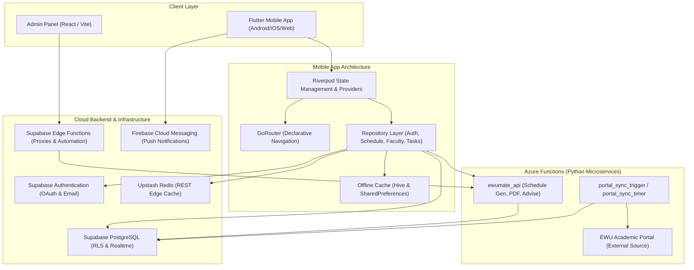

<!-- generated-by: gsd-doc-writer -->
# Architecture Overview

## System Overview
EWUmate is a multi-tier academic assistant platform built specifically for East West University (EWU) students and administrators. The solution couples a cross-platform Flutter mobile client with an offline-first caching layer (Hive and SharedPreferences), a real-time PostgreSQL backend on Supabase (featuring Row-Level Security, Edge Functions, and database triggers), high-performance Python microservices running on Azure Functions for automated portal scraping, routine schedule generation, and PDF document synthesis, an edge Redis cache via Upstash for fast course lookups, and a React-based administrative control panel. The system consumes student portal data and academic schedules, transforms and normalizes academic course loads, and outputs real-time timetable alerts, automated routine conflict resolutions, degree audits, and PDF cover sheets.

## Component Diagram

## Data Flow

1. **Client Bootstrapping and Session Resolution**:
   - `main()` triggers `_bootloader()` in `lib/main.dart` to initialize Hive caching (`CacheService`), Firebase app configuration (`Firebase.initializeApp`), and Supabase connection settings (`SupabaseConfig.initialize()`).
   - `SessionGuardian` and `appRouterProvider` evaluate the current authentication token. Unauthenticated users are routed to `/login`, while authenticated sessions are restored from local persistence and verified against Supabase Auth.

2. **Course & Routine Data Synchronization**:
   - On dashboard load, `DashboardRepository` queries `RedisService` / `CacheService` for cached schedules and active semester data.
   - If stale or absent, the client fetches the normalized schedule from Supabase `student_courses` and `schedules` tables via `ScheduleRepository`.
   - Routine data is hydrated into Riverpod state models and stored into local Hive storage for immediate offline retrieval on subsequent app launches.

3. **Cloud Schedule Generation Workflow**:
   - The user selects desired course codes and preference filters in `lib/features/schedule/`.
   - `AzureFunctionsService.generateSchedules()` dispatches an authenticated HTTP POST request with the user's Supabase JWT to the `/api/generate_schedules` endpoint on Azure Functions.
   - The Azure worker validates the user's token, runs combinatorial section-conflict algorithms against the active semester course master, and inserts generated routine permutations into Supabase under the user's session.

4. **Portal Synchronization & Scraping Pipeline**:
   - Administrative portal scrapers (`azure_functions/portal_sync_trigger` and scheduled timers) scrape course offerings and faculty catalogs from the university portal.
   - The parser standardizes section numbers, lab timings, instructor abbreviations, and classroom assignments, upserting cleansed datasets directly into Supabase and invalidating Upstash Redis cache keys.

## Key Abstractions

- **`AppConfig`** (`lib/core/config/supabase_config.dart`): Central environment configuration reader that accesses `flutter_dotenv` variables (`SUPABASE_URL`, `SUPABASE_ANON_KEY`, `AZURE_FUNCTION_URL`) with embedded fallback defaults.
- **`AzureFunctionsService`** (`lib/core/services/azure_functions_service.dart`): HTTP gateway managing authenticated calls to Azure Functions Python endpoints (`generate_schedules`, `triggerScraper`, `triggerFacultySync`, `getAdvisingCourses`).
- **`CacheService`** (`lib/core/services/cache_service.dart`): Persistent local data store using Hive boxes to guarantee Zero-Wait cold start and offline capability for student schedules, grades, and profile metadata.
- **`RedisService`** (`lib/core/services/redis_service.dart`): REST-based edge client interfacing with Upstash Redis for high-throughput course catalog queries and low-latency cache validation.
- **`AuthRepository`** (`lib/core/repositories/auth_repository.dart`): Coordinates authentication state, Google Sign-In tokens, and Supabase auth session lifecycle.
- **`ScheduleRepository`** (`lib/core/repositories/schedule_repository.dart`): Encapsulates routine loading, section lookups, time-slot parsing, and synchronization between Supabase and local cache.
- **`DashboardRepository`** (`lib/core/repositories/dashboard_repository.dart`): Aggregates user metrics, current day's classes, assignment deadlines, and active semester progress.
- **`AppRouter`** (`lib/core/router/app_router.dart`): Declarative GoRouter routing tree configuring top-level navigation, onboarding flows, bottom navigation tabs, and deep-linking handlers.

## Directory Structure Rationale

- **`lib/`**: Flutter mobile application root codebase.
  - **`lib/core/`**: Shared infrastructure code including configuration (`config/`), design tokens (`theme/`, `constants/`), persistent storage (`services/`), data abstractions (`repositories/`, `models/`), state utilities (`providers/`), navigation (`router/`), and reusable UI (`widgets/`).
  - **`lib/features/`**: Domain-driven feature modules organized by user journey (`auth/`, `dashboard/`, `schedule/`, `advising/`, `study_vault/`, `faculty_directory/`, `tasks/`, `results/`). Each feature encapsulates its own screens and presentation widgets.
- **`azure_functions/`**: Python serverless microservices hosting the parser engine (`ewumate_api/`), timer triggers (`portal_sync_timer/`), and automated portal synchronization scripts.
- **`admin_panel/`**: React/Vite web application serving as the administrative dashboard for managing course mappings, reviewing faculty data, and triggering system jobs.
- **`supabase/`**: PostgreSQL migrations, database schema definitions, and Edge Function handlers supporting real-time data pipelines and security policies.
- **`scripts/`**: Automation tools for course bulletin parsing, database auditing, bulk synchronization, and development maintenance.
- **`docs/`**: Project documentation covering architecture, APIs, deployment pipelines, configuration, and environment setup.
- **`test/`**: Unit, widget, and integration tests for validating client functionality.
